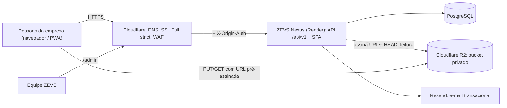
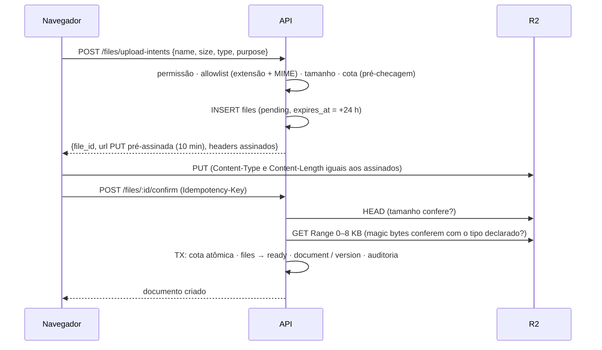
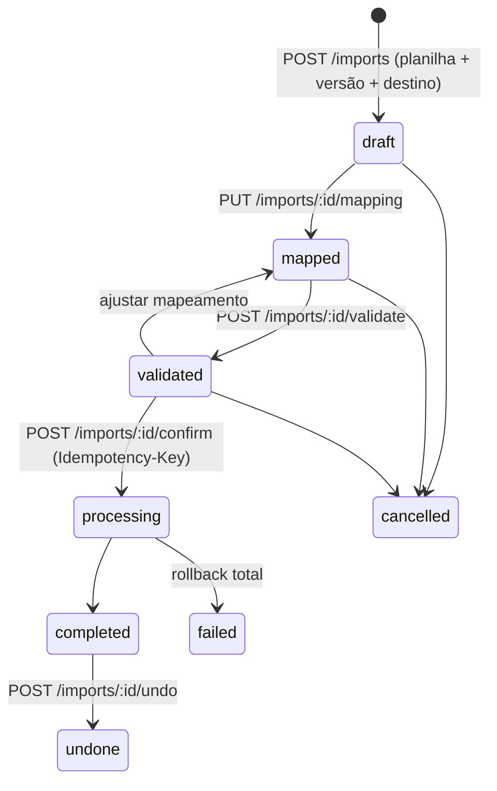
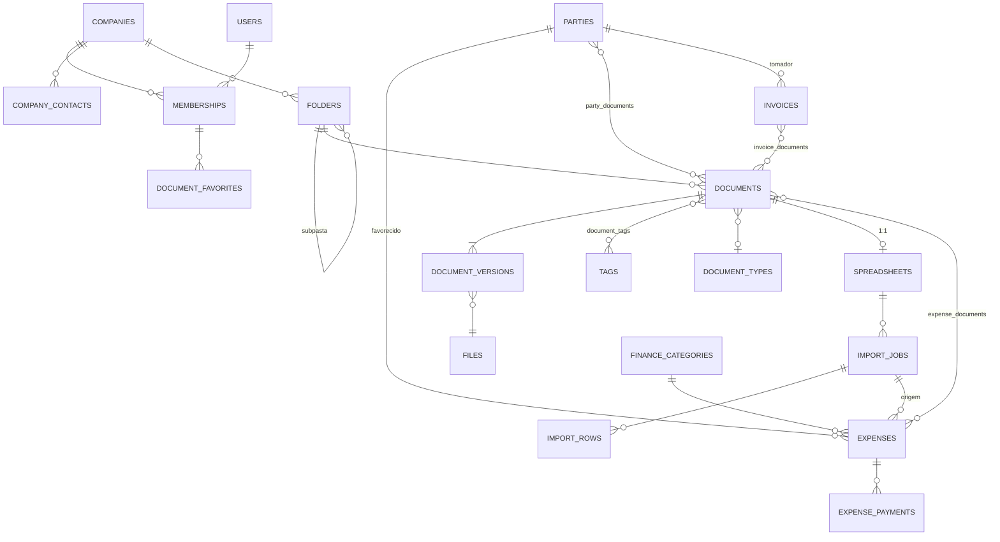

# ZEVS Nexus — Arquitetura

> **Aprovado em 09/10/2026** (D1–D13 em [`docs/FASE-0.md`](FASE-0.md)). Este documento é a fonte da verdade técnica: toda mudança de modelagem passa por aqui antes de virar código (pág. 20 da ZEVS STRUCTURE).
>
> Padrões de referência: **ZEVS STRUCTURE** (Notion). Quando este documento e a STRUCTURE divergirem, a divergência precisa estar registrada aqui, com motivo.

---

## 1. Visão

**ZEVS Nexus — Central de Organização Empresarial.** É um SaaS multi-tenant que centraliza informações administrativas, documentos, planilhas, notas fiscais e controles financeiros de uma empresa numa única plataforma. Funciona no computador e no celular.

- **Princípio:** robusto por dentro, simples por fora.
- **Filosofia:** centralizar o que hoje está espalhado, sem tornar a empresa refém de um sistema complexo.
- **Natureza:** sistema de **registro e organização**. O Nexus não paga, não emite nota fiscal e não movimenta saldo. Ele registra, organiza, encontra e alerta.
- **Primeiro cliente:** empresa de engenharia civil. **Nenhum comportamento é específico desse cliente.** Pastas, categorias, tipos de documento e especialidades de prestador são dados do tenant.

## 2. Contexto



O binário dos arquivos **não passa pelo servidor** no upload: vai direto do navegador para o R2, com uma URL assinada pelo backend. O servidor só lê o arquivo quando precisa (validação de magic bytes, prévia e importação de planilhas).

## 3. Topologia e stack

Topologia padrão ZEVS (pág. 01): **serviço único** no Render, servindo API e SPA na mesma origem (`SERVE_FRONTEND=true`), atrás do Cloudflare.

| Camada | Tecnologia |
|---|---|
| Runtime | Node.js 24 LTS, ESM (`"type": "module"`); CI testa 20 e 24 |
| HTTP | Express 5, helmet 8, cors, express-rate-limit 8, cookie-parser |
| Validação | Zod 4 (env, body, query, params), schemas `.strict()` |
| Banco | PostgreSQL 16+ (CI em 17), `pg` 8 sem ORM, node-pg-migrate 9 |
| Auth | jsonwebtoken 9 (HS256), bcryptjs 3 (custo 12) |
| Logs | pino 10 + pino-http 11, com request id e redaction |
| Frontend | HTML + ES Modules sem framework e sem bundler; Tailwind v4 compilado; sprite Lucide gerado no build; Chart.js vendorizado (só no Início) |
| Testes | Jest + Supertest; Playwright (se D12a for aprovado); ESLint 9 flat config |
| Infra | GitHub + Actions, Render (Virginia), Cloudflare, R2, Resend, monitor de uptime externo |

Dependências novas além do stack Core: a biblioteca de assinatura S3 para o R2 e a biblioteca de leitura de planilhas. As duas são escolhidas e registradas na fase em que entram (F3 e F6), com o critério "dependências mínimas" (pág. 06 §5).

## 4. Módulos

### 4.1 Estrutura do repositório

```plain text
backend/
  src/app.js               createApp() — testável sem listen
  src/server.js            listen + graceful shutdown
  src/config/env.js        Zod, falha rápido em produção
  src/shared/              db (pool, withTenant, withSystem), errors, http (validate, paginate,
                           sort allowlist), security (csrf, rate limits, origin), money (centavos,
                           pt-BR), dates (fuso da empresa), br-documents (CPF/CNPJ), csv, files
                           (magic bytes, nomes seguros)
  src/middlewares/         requestId, authenticate, tenantContext, requirePermission,
                           requireFeature, requirePlatformAdmin, idempotency
  src/modules/<módulo>/    x.routes.js · x.validator.js · x.controller.js · x.service.js ·
                           x.repository.js · providers/ (quando houver)
  src/jobs/                scheduleInterval + jobs de limpeza
  migrations/              NNNN_nome.js (node-pg-migrate)
  seeds/                   permissões, papéis, features, planos (idempotentes) · dev/ (demo)
  tests/                   unit/ · integration/ · security/ · concurrency/ · static/ · fixtures/
frontend/
  public/                  index.html (versão carimbada), favicon, assets/ (CSS e sprite gerados no build),
                           manifest, ícones e sw.js (F5), vendor/ (Chart.js, quando houver gráfico)
  scripts/                 build-icons.js (sprite Lucide), check-imports.js (grafia exata dos imports)
  src/                     app.js, router.js, guards.js
  src/services/            api (refresh + Web Locks), session, currentCompany, permissions, upload
  src/components/          DataTable, Modal, Drawer, Toast, ConfirmDialog, Form, MoneyInput,
                           DatePicker, PeriodPicker, Badge, KpiCard, EmptyState, LoadingState,
                           ErrorState, CommandPalette, Timeline, FileDrop, UploadProgress,
                           FolderTree, BottomBar
  src/layouts/             auth, app, admin
  src/views/               uma tela por arquivo, carregada sob demanda (import())
e2e/                       Playwright
docs/                      ARCHITECTURE, DATABASE, SECURITY, API, DEPLOYMENT, FASE-0, adr/
```

### 4.2 Módulos de backend

| Módulo | Responsabilidade | Usa o service de |
|---|---|---|
| `auth` | Cadastro, login, refresh, logout, reset, verificação, troca de senha, sessões | `users`, `audit` |
| `companies` | Empresa, contatos, configurações, branding, onboarding, uso/cota | `rbac`, `audit`, `documents` (pastas padrão), `finance` (categorias padrão) |
| `memberships` | Vínculos, convites (F10) | `rbac`, `plans`, `audit` |
| `rbac` | Catálogo, papéis, grant/deny, anti-escalada | `audit` |
| `audit` | Gravação append-only, consulta, atividade recente | — |
| `plans` | Planos, features, assinaturas, limites | — |
| `platform` | Painel ZEVS | `companies`, `plans`, `audit` |
| `storage` | Upload e download por URL assinada, validação, cota, limpeza | `companies` (cota), `audit` |
| `documents` | Pastas, documentos, versões, tags, tipos, favoritos, lixeira | `storage`, `audit` |
| `parties` | Prestadores, fornecedores, clientes | `documents`, `audit` |
| `finance` | Categorias, despesas, pagamentos, comprovantes | `parties`, `documents`, `audit` |
| `spreadsheets` | Metadados, visões, prévia | `documents`, `storage` |
| `imports` | Nível 3 da importação | `spreadsheets`, `storage`, `finance`, `parties`, `audit` |
| `invoices` | Notas fiscais e anexos | `parties`, `documents`, `audit` |
| `search` | Busca global composta por módulo | consultas de leitura dos módulos |
| `dashboard` | Blocos agregados por permissão | consultas de leitura dos módulos |

Regras de fronteira:

1. Um módulo só fala com outro pelo **service**.
2. SQL só existe no **repository**, sempre parametrizado e com `company_id`.
3. Controller só faz HTTP.
4. `search` e `dashboard` recebem de cada módulo uma função de leitura registrada, para que um módulo novo (ex.: obras) se acople sem editar os outros.

## 5. Fluxos principais

### 5.1 Registrar pagamento já feito ("Já paguei")

1. `POST /api/v1/files/upload-intents` para o comprovante (se houver foto ou arquivo) → upload direto ao R2 → `POST /api/v1/files/:id/confirm`.
2. `POST /api/v1/expenses` com `{ description, party_id, category_id, amount_cents, due_date, payment: { paid_on, amount_cents, method, file_id } }` e `Idempotency-Key`.
3. Numa única transação: cria a despesa, cria o pagamento, atualiza `paid_amount_cents` e `status = paid`, cria o documento do comprovante na pasta padrão (via `documents.service`), cria o vínculo em `expense_documents` e grava a auditoria.

### 5.2 Upload



Se a validação falhar, o objeto é apagado, `files.status` vira `rejected` e a resposta é 422.

### 5.3 Download

`POST /api/v1/documents/:id/download-url` → autentica, resolve o tenant, exige `documents.view`, carrega documento e versão com `company_id`, grava a auditoria `document.downloaded` e devolve `{ url, expires_at }`. A URL é `GET` pré-assinada de 60 s, com `response-content-disposition` (`attachment`; `inline` só para PDF e imagem) e `response-content-type` forçado.

A rota é `POST` e devolve JSON (em vez de um link direto) porque o access token vive em memória: um `<a href>` não carregaria o header `Authorization`.

### 5.4 Importação de planilha (nível 3)



A transição para `processing` é um `UPDATE … WHERE status = 'validated' RETURNING`: só uma confirmação vence.

### 5.5 Nota fiscal

Cria a nota como `processing` → anexa PDF/XML → `POST /invoices/:id/issue` (exige número e data) → `POST /invoices/:id/mark-paid` (data e valor recebido) → `POST /invoices/:id/archive`. Cada transição é uma ação explícita e auditada.

## 6. Multi-tenancy

Core integral da pág. 03 e dos ADRs 002 a 005.

- **Modelo:** banco e schema compartilhados, coluna `company_id`, tenant = empresa.
- **Resolução:** `JWT → usuário → membership ativa → empresa ativa`. O front envia `X-Company-Id` como **intenção**; o backend valida. O seletor de empresa fica oculto quando há só uma.
- **Camadas:**
  1. `tenantContext` monta `req.tenant = { companyId, membershipId, roles, permissions, features }`.
  2. `tenantRouter()` com guarda estática: o teste falha se um `*.routes.js` novo não usar o router.
  3. Repository escopado: `companyId` como 1º argumento; `scopedTable` impõe `company_id` no INSERT e aplica a allowlist de colunas.
  4. FK composta `(company_id, x_id) → x(company_id, id)` em toda relação interna.
  5. `withTenant(companyId, fn)` em toda transação de tenant, setando `app.company_id`. As policies RLS são ligadas na F10 (D2). `withSystem()` serve a jobs e ao Painel ZEVS.
  6. Suíte A × B por módulo.
- **Respostas:** outro tenant ou recurso inexistente → **404 idêntico**. Empresa ou acesso suspenso → 403 com `COMPANY_SUSPENDED`, `COMPANY_PENDING` ou `MEMBERSHIP_SUSPENDED`. `company_id` no body → 422 (`.strict()`). Referência no body a registro de outro tenant (prestador, categoria, pasta, documento) → 422.
- **Arquivos:** a chave `companies/<company_id>/files/<file_id>` é gerada só pelo servidor. O cliente nunca envia nem recebe uma chave de storage, só ids de documento.
- **CNPJ não é único na plataforma.** Exigir unicidade revelaria a outro tenant que aquele CNPJ já está cadastrado (enumeração). Duplicidade é assunto do Painel ZEVS.
- **Onboarding** numa transação: empresa (`pending`) + settings + branding + membership owner + assinatura (plano padrão) + defaults (pastas sugeridas, tipos de documento, categorias), todos como dados editáveis.

## 7. Autenticação e sessão

Pacote do Wash (pág. 04, ADR-007), aplicado integralmente.

| Item | Regra |
|---|---|
| Senha | bcryptjs 12; mínimo 8 caracteres, máximo 72 bytes (recusada, não truncada); regra visível |
| Access token | JWT HS256, 15 min, `{ sub, aud: 'app', jti }`, sem papel e sem tenant, `alg` fixo; usuário recarregado a cada request; **só em memória** |
| Refresh token | Opaco (48 bytes), só o hash SHA-256 no banco; cookie `__Secure-` `HttpOnly; Secure; SameSite=Strict; Path=/api/v1/auth`; 7 dias deslizantes, teto de 30 por família |
| Rotação | A cada uso (`replaced_by_id`). Reuso de token rotacionado há mais de 15 s → revoga a família, audita `auth.refresh_reuse` e manda e-mail |
| CSRF | Header `X-ZN-CSRF: 1` + `Origin` na allowlist + `Sec-Fetch-Site ≠ cross-site` nas rotas por cookie |
| Entre abas | Refresh serializado com `navigator.locks`; logout propagado por `BroadcastChannel` |
| Login | Mesma resposta e mesmo tempo para e-mail inexistente e senha errada |
| Reset | Token de uso único, 1 h, só o mais recente vale; resposta genérica; envio assíncrono; derruba todas as sessões |
| Troca de senha | Exige a atual; derruba as outras sessões |
| Verificação de e-mail | Token de 7 dias; obrigatória para a empresa sair de `pending` |
| Links | Base `APP_URL`, nunca o header `Host`; o token sai da barra de endereço assim que a tela abre |
| Sessões | "Sair" revoga a família atual; "Sair de todos os dispositivos" revoga todas; lista de sessões ativas na F10 |

### 7.1 Como ficou na implementação (F1)

- **Cadastro:** sempre `202` com a mesma resposta. O bcrypt roda antes da consulta, para o tempo não revelar se o e-mail existe. Para e-mail novo, cria a conta e envia o link de verificação; para e-mail já cadastrado, não muda nada e avisa o dono do e-mail.
- **Login antes da verificação:** permitido. A verificação é exigida para ativar a empresa (F2). Se alguém cadastrar o e-mail de outra pessoa, o dono legítimo recupera a conta por "Esqueci minha senha": o reset prova o controle da caixa, troca a senha, derruba as sessões e marca o e-mail como verificado.
- **Corrida entre abas:** um refresh rotacionado há até 15 s devolve **só** um access token novo, sem cookie (a outra aba já recebeu o cookie novo). Depois de 15 s, é reuso: a família inteira é revogada e o usuário recebe um e-mail de alerta.
- **Revogação de access tokens:** `users.sessions_revoked_at`. Tokens com `iat` anterior ao segundo da revogação são recusados (logout geral, reset e troca de senha). O instante é gravado pelo relógio da aplicação, o mesmo que assina o `iat`.
- **Cookie:** `zn_rt` em http (desenvolvimento) e `__Secure-zn_rt` em https; `HttpOnly; SameSite=Strict; Path=/api/v1/auth`.
- **Comparações de validade dos tokens** usam o relógio do banco (`now()`) num único lugar: o repository.
| Entrada de clientes | Cadastro público → onboarding → empresa `pending` → Platform Admin aprova (D3) |

## 8. Autorização (RBAC)

- Permissões efetivas = **(papéis ∪ grants) − denies**, resolvidas a cada requisição numa única query.
- `requirePermission(...codes)` na rota. Checagem fina no service quando depende do registro (ex.: a importação exige `spreadsheets.import` **e** `finance.manage`).
- O front só esconde; quem decide é o backend.
- **Omissão de campos:** sem `finance.view`, dashboard, busca e listas não trazem valores monetários.
- **Anti-escalada:** `CANNOT_CHANGE_SELF`, `PRIVILEGE_ESCALATION`, `OWNER_PROTECTED` / `TARGET_OUTRANKS`, `LAST_OWNER`; a membership-alvo é travada com `FOR UPDATE` e a auditoria é gravada na mesma transação.
- **Landing:** owner, admin, financeiro e visualização caem no Início; assistente cai em Documentos.
- **Platform Admin:** tabela `platform_admins` + `PLATFORM_ADMIN_EMAILS` (bootstrap só com e-mail verificado). Opera em `withSystem()` e audita na empresa afetada. Dono de empresa recebe 403 em `/api/v1/admin/*`.

Catálogo e matriz de papéis: ver FASE-0, D10.

## 9. Banco de dados

### 9.1 Convenções (pág. 07)

| Convenção | Regra |
|---|---|
| PK | `id uuid default gen_random_uuid()` |
| Tenant | `company_id uuid not null`; tabelas pai com `unique (company_id, id)`; filhas com FK composta |
| Dinheiro | `bigint` em `*_cents`, com `check (>= 0)` (ou `> 0` em valores de lançamento); `SUM(x)::bigint`; nunca float |
| Datas | `timestamptz` para instantes; `date` para vencimento, pagamento, emissão e competência, interpretados no `companies.timezone` |
| Enums | `text` + `CHECK` |
| Soft delete | `deleted_at` em cadastros, documentos, despesas e notas; unicidade por índice parcial entre ativos |
| Concorrência | `version integer` em `companies`, `parties`, `documents`, `expenses`, `invoices`; `PATCH` exige `version` → 409 `VERSION_CONFLICT` |
| Autoria | `created_by`, `updated_by` |
| Append-only | Trigger `prevent_mutation` em `audit_logs` |
| Saldo derivado | `expenses.paid_amount_cents` e `company_usage.storage_bytes` só mudam por uma função com `UPDATE` atômico condicional |
| Busca | `search_text` gerada com `f_unaccent(lower(...))` + GIN trigram, por empresa |
| Documentos BR | CPF/CNPJ validados por dígito verificador, inclusive CNPJ alfanumérico; guardados normalizados |

### 9.2 Ordem das migrations

```plain text
0001_extensions      pgcrypto, citext, pg_trgm, unaccent + f_unaccent(); triggers set_updated_at e prevent_mutation
0002_users_auth      users, refresh_tokens, password_reset_tokens, email_verification_tokens
0003_companies       companies, company_settings, company_branding, company_contacts, company_usage
0004_memberships     memberships, invitations
0005_rbac            roles, permissions, role_permissions, membership_roles, membership_permissions
0006_audit           audit_logs (+ prevent_mutation)
0007_platform        platform_admins, plans, features, plan_features, subscriptions, company_features
0008_idempotency     idempotency_keys
0009_documents       files, folders, document_types, documents, document_versions, tags, document_tags,
                     document_favorites; company_settings ganha as pastas padrão
0010_parties         parties, party_documents
0011_finance         finance_categories, expenses, expense_payments, expense_documents
0012_spreadsheets    spreadsheets
0013_invoices        invoices, invoice_documents
0014_imports         import_jobs, import_rows; expenses ganha source_import_id e source_row_number
```

Cada migration cria suas tabelas **com os seus índices**, com o tenant primeiro. Toda migration tem `down`, e o CI prova `up → down → up` do zero.

### 9.3 Modelo conceitual (domínio)



### 9.4 Tabelas de domínio (colunas principais)

Todas têm `id`, `company_id`, `created_at`, `updated_at` e, onde fizer sentido, `created_by`, `updated_by`, `deleted_at`, `version`.

| Tabela | Colunas principais | Restrições e índices |
|---|---|---|
| `companies` | `legal_name`, `trade_name`, `cnpj`, `status` (`pending`/`active`/`suspended`), `timezone`, `state_registration`, `municipal_registration`, `tax_regime`, endereço (`cep`, `street`, `number`, `complement`, `district`, `city`, `state`), `email`, `phone` | `timezone` validado contra a lista IANA |
| `company_settings` | `upcoming_window_days` (7), `invoice_pending_alert_days`, pastas padrão (`company_folder_id`, `receipts_folder_id`, `invoices_folder_id`, `spreadsheets_folder_id`) | Pastas padrão com FK composta; `null` = raiz |
| `company_branding` | `primary_color` | `#RRGGBB` (Zod + `CHECK`) |
| `company_contacts` | `name`, `role_title`, `email`, `phone`, `is_responsible`, `notes` | — |
| `company_usage` | `storage_bytes`, `file_count` | `check (storage_bytes >= 0)` |
| `files` | `storage_key`, `original_name`, `extension`, `content_type`, `size_bytes`, `sha256`, `status` (`pending`/`ready`/`rejected`/`deleted`), `expires_at`, `uploaded_by`, `confirmed_at` | `unique (storage_key)`; índice `(status, expires_at)` para limpeza |
| `folders` | `parent_id`, `name` | FK composta para o próprio `folders`; `unique nulls not distinct (company_id, parent_id, lower(name))` entre ativos; profundidade máxima 8; sem ciclo (validado no service) |
| `document_types` | `name`, `archived_at` | Único por empresa entre ativos |
| `documents` | `folder_id`, `title`, `description`, `document_type_id`, `expires_on` (se aprovado em D5), `archived_at`, `search_text` | Índices `(company_id, folder_id)`, `(company_id, updated_at desc)`, GIN em `search_text` |
| `document_versions` | `document_id`, `version_number`, `file_id`, `comment`, `created_by` | `unique (company_id, document_id, version_number)`; sem UPDATE pelo repository; versão atual = maior `version_number` |
| `tags` / `document_tags` | `name` / (`document_id`, `tag_id`) | Tag única por empresa (case-insensitive) |
| `document_favorites` | `membership_id`, `document_id` | PK `(company_id, membership_id, document_id)` |
| `parties` | `person_type` (`individual`/`company`), `name`, `trade_name`, `document_normalized`, `roles` (`supplier`/`service_provider`/`customer`), `specialty`, `email` (citext), `phone`, `phone_digits` (gerada), `pix_key`, `notes`, `search_text` | `roles` não vazio e contido na lista; único `(company_id, document_normalized)` entre ativos com documento |
| `party_documents` | `party_id`, `document_id` | PK composta; FKs compostas |
| `finance_categories` | `kind` (`expense`/`income`), `name`, `sort_order`, `archived_at` | Única `(company_id, kind, lower(name))` entre ativas |
| `expenses` | `description`, `party_id`, `category_id`, `amount_cents`, `paid_amount_cents`, `due_date`, `status`, `scheduled_for`, `cancelled_at`, `cancel_reason`, `notes`, `source_import_id`, `source_row_number`, `search_text` | `amount_cents > 0`; `0 <= paid_amount_cents <= amount_cents`; status em (`pending`, `scheduled`, `partially_paid`, `paid`, `cancelled`); índices `(company_id, status, due_date)`, `(company_id, party_id)`, `(company_id, category_id)` |
| `expense_payments` | `expense_id`, `paid_on`, `amount_cents`, `method`, `reference`, `notes`, `voided_at`, `voided_by`, `void_reason` | `amount_cents > 0`; `method` em (`pix`, `boleto`, `transfer`, `cash`, `card`, `check`, `other`); índices `(company_id, paid_on)`, `(company_id, expense_id)` |
| `expense_documents` | `expense_id`, `payment_id` (opcional), `document_id`, `role` (`receipt`/`invoice`/`boleto`/`contract`/`other`) | PK `(company_id, expense_id, document_id)` |
| `spreadsheets` | `document_id`, `in_use`, `reference_year` | `unique (company_id, document_id)`; índice `(company_id, in_use, reference_year)` |
| `import_jobs` | `document_id`, `document_version_id`, `target` (`expenses`), `status`, `sheet_name`, `header_row`, `mapping` (jsonb validado por Zod), `options`, `file_sha256`, contadores (`total`, `valid`, `invalid`, `duplicates`, `imported`), `error`, `confirmed_by`, `confirmed_at`, `completed_at`, `undone_at` | Índice `(company_id, file_sha256)` para aviso de arquivo repetido |
| `import_rows` | `import_job_id`, `row_number`, `raw` (limitado), `normalized`, `status` (`valid`/`invalid`/`duplicate`/`excluded`/`imported`), `errors`, `created_entity_id` | PK `(company_id, import_job_id, row_number)`; removidas 90 dias após a conclusão (o resumo do job fica) |
| `invoices` | `direction` (`issued`/`received`), `kind` (`nfse`/`nfe`/`other`), `number`, `series`, `issue_date`, `competence_date`, `customer_party_id`, `description`, `gross_amount_cents`, `withheld_amount_cents`, `net_amount_cents` (gerada), `due_date`, `status` (`processing`/`issued`/`cancelled`), `payment_status` (`pending`/`paid`), `paid_on`, `received_amount_cents`, `verification_code`, `archived_at`, `notes`, `search_text` | `withheld <= gross`; `issued` exige `number` e `issue_date`; `paid` exige `status = issued`; único `(company_id, direction, kind, coalesce(series,''), number)` entre ativas com número |
| `invoice_documents` | `invoice_id`, `document_id`, `role` (`pdf`/`xml`/`receipt`/`other`) | PK composta |
| `idempotency_keys` | `scope`, `key`, `request_hash`, `status`, `response_status`, `response_body`, `expires_at` | `unique (company_id, scope, key)` |
| `audit_logs` | `company_id` (nulo em eventos só do usuário, como login), `actor_type` (`user`/`platform_admin`/`system`), `actor_user_id`, `action`, `entity_type`, `entity_id`, `request_id`, `ip`, `user_agent`, `metadata` | Append-only por trigger; índices `(company_id, created_at desc)` e `(company_id, entity_type, entity_id)` |

## 10. Armazenamento

### 10.1 Interface

```plain text
StorageProvider
  createUploadUrl({ key, contentType, contentLength, expiresIn }) → { url, headers }
  createDownloadUrl({ key, filename, contentType, disposition, expiresIn }) → url
  head(key)                → { size, contentType } | null
  readRange(key, from, to) → Buffer
  getStream(key)           → Readable        (prévia e importação de planilhas)
  delete(key)
```

| Provider | Uso | Observação |
|---|---|---|
| `r2` | Staging e produção | Bucket privado por ambiente (`nexus-staging`, `nexus-prod`); CORS liberando só `PUT`/`GET` a partir de `APP_URL` |
| `local` | Desenvolvimento | Disco em `.storage/` + rotas de dev com URL assinada por HMAC; **o boot falha se `NODE_ENV=production`** |
| `memory` | Testes | Simula URL assinada e permite injetar arquivos de fixture |

### 10.2 Regras

- **Chave:** `companies/<company_id>/files/<file_id>`, sem nome original e sem extensão. Path traversal é impossível por construção.
- **Nome exibido:** o original, sanitizado (sem caracteres de controle e sem separadores de caminho, até 200 caracteres). No download vai em `Content-Disposition` com `filename*=UTF-8''…` (RFC 5987) e sem CR/LF.
- **Allowlist:** `pdf, xml, xlsx, xls, csv, ods, docx, doc, odt, txt, jpg, jpeg, png, webp`, checada em três pontos: extensão, MIME declarado e **magic bytes** na confirmação. Bloqueados: executáveis, scripts, HTML, SVG, arquivos com macro (`xlsm`, `docm`) e compactados.
- **Tamanho:** até 25 MB por arquivo (parâmetro do plano). O `Content-Length` vai **assinado** na URL de PUT.
- **Cota:** `UPDATE company_usage SET storage_bytes = storage_bytes + $size WHERE company_id = $1 AND storage_bytes + $size <= $quota RETURNING …`. Se nenhuma linha for afetada → 422 `STORAGE_QUOTA_EXCEEDED`. Excluir definitivamente devolve a cota.
- **URLs:** PUT de 10 min; GET de 60 s. Nunca vão para log (a redaction tira query strings). `Referrer-Policy: no-referrer` nas respostas da API.
- **CSP:** `connect-src` e `img-src` incluem o endpoint S3 da conta R2. A prévia de PDF abre em nova aba, sem `frame-src`.
- **Isolamento de conteúdo:** arquivos enviados são servidos pelo domínio do R2, nunca pela origem do app. Um HTML ou PDF malicioso não tem acesso a cookies nem ao DOM do Nexus.
- **Limpeza (job):** `files` em `pending` com `expires_at` vencido → apaga o objeto e a linha (de hora em hora).
- **Exclusão física** só por job, depois da retenção da lixeira (F10). Nenhuma rota apaga um objeto do storage diretamente.
- **Backup de arquivos (D12f):** cópia diária dos objetos novos para um segundo bucket. A implementação é definida na F5.

## 11. Documentos

- **"Um arquivo, um lugar":** todo arquivo é um `document`. Financeiro, Notas, Planilhas e Prestadores **vinculam** documentos.
- **Pastas:** árvore por empresa (lista de adjacência, CTE recursiva para breadcrumb). Mover verifica ciclo e profundidade. Pastas sugeridas no onboarding (dados editáveis): Empresa · Financeiro › Comprovantes · Notas fiscais · Planilhas · Contratos · Prestadores · Outros. Apagar uma pasta padrão limpa a configuração correspondente, e o destino volta a ser a raiz.
- **Classificação:** pasta (onde está) + tags (rótulos transversais) + tipo de documento (a "categoria"; lista editável sugerida no onboarding: Contrato, Comprovante, Nota fiscal, Boleto, Certidão, Documento da empresa, Planilha, Outro).
- **Versões:**
  - "Enviar nova versão" cria `document_versions` com `version_number + 1`;
  - "Restaurar versão" cria uma nova versão apontando para o `file_id` antigo, de modo que o histórico nunca se reescreve;
  - a versão atual é a de maior número.
- **Estados:** ativo → arquivado (`archived_at`, sai das listas padrão) → lixeira (`deleted_at`, restaurável) → excluído definitivamente (job, F10).
- **Favoritos:** por membro.
- **Histórico:** versões + auditoria do documento (quem enviou, moveu, renomeou, baixou, arquivou).
- **Listas:** paginação, busca, filtros (pasta, tipo, tag, período, favoritos, arquivados) e ordenação **no servidor**. Lista no desktop, cartões no celular, filtros em gaveta.
- **Envio:** arrastar e soltar (desktop), "Tirar foto" e "Escolher arquivo" (celular), vários arquivos de uma vez, com progresso por arquivo.
- **Validade (se D5.3 for aprovado):** `expires_on` opcional, com alerta "vence em 30 dias" no Início.
- **Futuro:** pastas com acesso restrito, extração de texto ou OCR, assinatura digital.

## 12. Financeiro e prestadores

- **Despesa** (`expenses`): obrigação. **Pagamento** (`expense_payments`): baixa efetiva; uma despesa aceita 1..N pagamentos.
- **Status gravados:** `pending` · `scheduled` · `partially_paid` · `paid` · `cancelled`.
- **Vencida (calculada):** `status in (pending, scheduled, partially_paid) and due_date < (now() at time zone companies.timezone)::date`.
- **Registrar pagamento:**
  1. `SELECT … FOR UPDATE` da despesa com `company_id`;
  2. conferir `paid_amount_cents + valor <= amount_cents`;
  3. inserir o pagamento;
  4. atualizar `paid_amount_cents` e o status pela função única;
  5. gravar a auditoria — tudo na mesma transação.
- **Estornar:** marca `voided_*` (motivo obrigatório), recalcula pela mesma função e audita. Valor e data de pagamento nunca são editados.
- **Cancelar despesa:** só sem pagamentos ativos. Despesa com pagamento exige estorno antes.
- **"Já paguei":** despesa + pagamento + comprovante numa requisição (§5.1).
- **Categorias:** `kind` `expense` / `income`. As sugeridas no onboarding são genéricas e editáveis: Mão de obra, Materiais, Serviços de terceiros, Impostos e taxas, Aluguel, Contas de consumo, Folha e pró-labore, Equipamentos e ferramentas, Transporte e combustível, Tarifas bancárias, Outros.
- **Prestadores e fornecedores** (`parties`): pessoa física ou jurídica, CPF/CNPJ opcional e validado, `roles`, `specialty` livre ("Eletricista"), contato, chave PIX e observações. A ficha mostra o histórico de despesas e pagamentos e os documentos vinculados. Prestador pessoa física é **titular de dados (LGPD)**.
- **Indicadores** (definições na FASE-0, D4): A pagar vencido · Vence em 7 dias · Pago no período (caixa) · Despesas do período (vencimento).
- **Telas:** abas Pendentes · Vencidas · Próximas · Pagas · Canceladas; cartão com prestador, valor, vencimento e selo de status; formulário de uma tela (`Ctrl+Enter` salva); "Registrar pagamento" em gaveta; filtros em gaveta no celular.

## 13. Planilhas e importação

### 13.1 Planilhas (níveis 1 e 2)

- **Planilha = documento** de tipo `xlsx`, `xls`, `csv` ou `ods`. O registro em `spreadsheets` é criado automaticamente quando o documento recebe uma versão desse tipo.
- **Metadados:** `in_use`, `reference_year` (sugerido por `File.lastModified` no navegador e editável).
- **Visões (filtros):** Em uso · Deste ano · Antigas · Arquivadas · Importadas (regras na FASE-0, D6). Ações em lote: marcar ou desmarcar "em uso", arquivar e mudar o ano.
- **Prévia (nível 2):** leitura em streaming no servidor, só **XLSX, CSV e ODS**; abas, linhas paginadas (50 por página) e no máximo 200 colunas exibidas. Fórmulas **não** são avaliadas: aparece o valor calculado salvo no arquivo. Toda célula é renderizada como texto, com escape. **XLS legado:** só armazenamento e download.
- **Limites de leitura:** arquivo de até 10 MB para prévia ou importação; teto de bytes descompactados, de linhas lidas, de colunas e de tempo, contra zip bomb e arquivo patológico. Estourou → 422 com a mensagem "planilha grande demais para visualizar; baixe o arquivo".
- **Biblioteca:** escolhida na F6 com as planilhas reais. Candidatas: ExcelJS (XLSX, com leitor em streaming) e parser de CSV próprio ou `csv-parse`. Excluída: `xlsx` do npm (0.18.5, com CVEs conhecidos e correções publicadas fora do npm).

### 13.2 Importação estruturada (nível 3, F9)

- **Destino inicial:** despesas (com pagamento quando a linha tiver data de pagamento) e, opcionalmente, criação de prestadores.
- **Análise:** abas, linha de cabeçalho detectada (editável) e amostra por coluna.
- **Mapeamento:** coluna → campo (`description`, `amount`, `due_date`, `paid_on`, `method`, `party_name`, `party_document`, `category`, `notes`). Também: formato de data e de número (pt-BR por padrão: `1.500,00` e `dd/mm/aaaa`) e regra para prestador (achar por documento, depois por nome normalizado; criar novo ou deixar sem prestador).
- **Validação:** um schema Zod por linha. Os erros são guardados por linha e coluna, com mensagem em PT-BR.
- **Duplicidade:**
  - o mesmo arquivo (`sha256`) já importado gera aviso e exige confirmação explícita;
  - uma linha igual a despesa existente (mesmo prestador, valor e vencimento) ou a outra linha do arquivo é marcada **possível duplicada** e não entra por padrão; o usuário decide.
- **Prévia:** contadores (válidas, inválidas, duplicadas), lista filtrável e opção de excluir linhas.
- **Confirmação:**
  - `Idempotency-Key` + transição atômica de estado;
  - **uma transação** para tudo, até 5.000 linhas, em lotes de `INSERT`;
  - qualquer falha → rollback total e status `failed`.
- **Rastreabilidade:** cada despesa criada guarda `source_import_id` e `source_row_number`, e a tela mostra "importada da linha 37 de *Controle 2025.xlsx*, versão 3".
- **Desfazer:** soft delete dos registros da importação cujo `version` não mudou desde a criação. Os alterados depois são listados e preservados.
- **Nunca:** atualizar registro existente, excluir registro por ausência na planilha, avaliar fórmula.
- **Relatório de erros:** CSV pt-BR (BOM, `;`, vírgula decimal), com proteção contra fórmula.
- **Execução:** síncrona com teto. Se a medição mostrar necessidade, o executor passa a ser um job in-process que consome `import_jobs` (o modelo não muda).
- **Futuro:** mapeamentos salvos para planilhas recorrentes, outros destinos (notas, prestadores), atualização por chave externa explícita.

## 14. Notas fiscais

- **Escopo MVP:** notas **emitidas** pela empresa (`direction = 'issued'`). Nota **recebida** de fornecedor entra como documento vinculado à despesa.
- **Três dimensões:** `status` (`processing` → `issued` → `cancelled`), `payment_status` (`pending` → `paid`) e `archived_at`.
- **Visões:** Em processamento · Emitidas · Pendentes · Pagas · Finalizadas (emitida e paga, calculada) · Canceladas · Arquivadas.
- **Transições:**

  | De | Ação | Para | Exige |
  |---|---|---|---|
  | `processing` | Marcar emitida | `issued` | Número e data de emissão |
  | `processing` / `issued` | Cancelar | `cancelled` | Motivo; não pode estar paga |
  | `issued` + `pending` | Marcar paga | `paid` | Data e valor recebido |
  | `paid` | Desfazer pagamento | `pending` | Motivo (auditado) |
  | qualquer | Arquivar / desarquivar | — | — |

- **Valores:** bruto, retenções (total) e líquido calculado. O valor recebido é sugerido igual ao líquido e pode ser editado.
- **Anexos:** PDF, XML e comprovante como documentos vinculados (`invoice_documents`), gravados na pasta padrão de notas.
- **XML:** só armazenado no MVP. A leitura automática (futura) usa parser sem DTD e sem entidades externas.
- **Sem integração fiscal.** `FiscalProvider` (ADR-014) só entra por decisão explícita.

## 15. Busca global

- `GET /api/v1/search?q=&types=`: `UNION ALL` de uma consulta por módulo, **cada uma incluída só se a pessoa tem `<módulo>.view`**.
- Cada tabela pesquisável tem `search_text` gerada (`f_unaccent(lower(...))`) e índice GIN trigram por empresa.
- O texto do usuário é sempre literal: os curingas `%` e `_` são escapados.
- **Ranking:** `similarity()` + recência. Até 5 resultados por grupo, com "ver todos" levando à lista do módulo com o filtro aplicado.
- **Busca a partir do prestador:** se `q` casa com um prestador, os grupos "Despesas" e "Documentos" incluem os vinculados a ele ("eletricista" → prestador → pagamentos → comprovantes).
- **Escopo:** documentos (título, nome do arquivo, descrição, tags, pasta), planilhas, notas, despesas, prestadores e contatos da empresa.
- **Sem `finance.view`:** os resultados de despesas e notas vêm sem valores.
- **UI:** campo no cabeçalho (desktop), lupa que abre um overlay (celular), `Ctrl+K` e `/`.

## 16. Dashboard (Início)

- Endpoint único `GET /api/v1/dashboard?period=` com um conjunto pequeno de agregações, numa transação com `SET LOCAL statement_timeout = '10s'`.
- **Blocos, cada um com a sua permissão:**

  | Bloco | Conteúdo | Permissão |
  |---|---|---|
  | A pagar | Vencido, vence em 7 dias, pendente total (quantidade + valor) | `finance.view` |
  | Pagamentos | Pago no período × período anterior | `finance.view` |
  | Notas | Em processamento, pendentes de recebimento (quantidade + valor), recebido no período | `invoices.view` |
  | Documentos | 5 recentes, favoritos | `documents.view` |
  | Planilhas | Em uso, recentes | `spreadsheets.view` |
  | Atividade | Últimas ações (auditoria) só de entidades que a pessoa pode ver | conforme a entidade |
  | Alertas | Pagamentos vencidos, notas pendentes há mais de N dias, documentos vencendo (se D5.3) | conforme o alerta |

- Períodos calculados no servidor, no fuso da empresa (hoje, 7 d, 30 d, este mês, mês anterior, este ano, personalizado de até 2 anos). As séries não têm buracos.
- **Celular:** blocos em cartões, os mais urgentes primeiro; botão **+** com "Registrar pagamento", "Enviar documento" e "Nova nota".

## 17. API

### 17.1 Convenções

- Prefixo **`/api/v1`**. Fora da versão: `GET /health`, `GET /ready`, `GET /api/version`.
- **Cadeia global:** requestId → helmet → cors → pino-http → `express.json` (1 MB) → cookie-parser → rate limit global (só `/api`) → rotas → notFound → errorHandler.
- **Pipeline de recurso de tenant:** `authenticate → tenantContext → [requireFeature] → requirePermission → validate → [idempotency] → controller`.
- **Resposta:** `{ data, meta }` em sucesso; `{ error: { code, message, details, requestId } }` em erro. 5xx genérico em produção.
- **Erros:** `ValidationError` 422 · `AuthenticationError` 401 · `AuthorizationError` 403 · `NotFoundError` 404 · `ConflictError` 409 · `FeatureDisabledError` 403 · `RateLimitError` 429 · `BadRequestError` 400 · `StorageError` 502.
- **Paginação:** `page` / `limit` (padrão 20, máximo 100). A ordenação usa allowlist por recurso, e fora dela → 422.
- **Ações de estado** são sub-recursos `POST` explícitos (`/issue`, `/cancel`, `/mark-paid`, `/void`), nunca um `PATCH` de `status`.
- **Idempotência:** `Idempotency-Key` obrigatório em criação de despesa e de pagamento, confirmação de upload, confirmação de importação e criação de nota.

### 17.2 Mapa de endpoints

| Área | Endpoints |
|---|---|
| Auth | `POST /auth/register`, `/auth/login`, `/auth/refresh`, `/auth/logout`, `/auth/logout-all`, `/auth/password/forgot`, `/auth/password/reset`, `/auth/password/change`, `/auth/email/verify`, `/auth/email/resend` · `GET /me` (usuário, empresas, permissões e features da empresa atual) |
| Empresa | `POST /companies` (onboarding) · `GET`/`PATCH /company` · CRUD `/company/contacts` · `GET`/`PATCH /company/settings` |
| Configurações | CRUD `/finance-categories`, `/document-types`, `/tags` |
| Arquivos | `POST /files/upload-intents` · `POST /files/:id/confirm` |
| Documentos | CRUD `/folders` + `POST /folders/:id/move` · CRUD `/documents` + `POST /documents/:id/versions`, `/documents/:id/versions/:n/restore`, `/documents/:id/download-url`, `/documents/:id/move`, `/documents/:id/archive`, `/documents/:id/unarchive`, `/documents/:id/favorite` (+ `DELETE`) · `GET /documents/:id/history` · `GET /trash` + `POST /trash/:id/restore` |
| Prestadores | CRUD `/parties` · `GET /parties/:id/expenses`, `/parties/:id/documents` · `POST /parties/:id/documents` |
| Financeiro | CRUD `/expenses` · `POST /expenses/:id/payments`, `/expenses/:id/cancel`, `/expenses/:id/documents` · `POST /expense-payments/:id/void` |
| Planilhas | `GET /spreadsheets?view=in_use\|this_year\|older\|archived\|imported` · `PATCH /spreadsheets/:id` · `POST /spreadsheets/bulk` · `GET /spreadsheets/:id/preview?sheet=&page=` |
| Importação | `POST /imports` · `GET /imports/:id` · `PUT /imports/:id/mapping` · `POST /imports/:id/validate` · `GET /imports/:id/rows?status=` · `POST /imports/:id/confirm` · `POST /imports/:id/cancel` · `POST /imports/:id/undo` · `GET /imports/:id/error-report` |
| Notas | CRUD `/invoices` · `POST /invoices/:id/issue`, `/invoices/:id/cancel`, `/invoices/:id/mark-paid`, `/invoices/:id/mark-unpaid`, `/invoices/:id/archive`, `/invoices/:id/unarchive`, `/invoices/:id/documents` |
| Transversal | `GET /search` · `GET /dashboard` · `GET /audit-logs` |
| Equipe (F10) | `/members`, `/invitations`, `/sessions` |
| Painel ZEVS | `/admin/companies` (+ `/approve`, `/suspend`, `/reactivate`), `/admin/plans`, `/admin/companies/:id/features`, `/admin/usage`, `/admin/audit-logs`, `/admin/platform-admins` |

O detalhe de cada contrato vai para `docs/API.md` na fase correspondente.

## 18. Frontend (SPA)

- **Um único `index.html`**, router com History API e URLs limpas; o backend faz o fallback de qualquer GET fora de `/api`. Uma tela por arquivo, com `import()` sob demanda.
- **Guardas:** auth → tenant → permission → feature. Só escondem; o backend autoriza.
- **Sessão:** no boot, `POST /api/v1/auth/refresh` (cookie) → access token em memória. `X-Company-Id` vem da empresa selecionada. `localStorage` só guarda preferências (filtros, colunas, empresa selecionada), com try/catch.
- **XSS:** template `html` com escape automático; `innerHTML` proibido por lint; `safeUrl()`; `?next=` só aceita caminho interno.
- **Rotas:**

  | Área | Rotas |
  |---|---|
  | Públicas | `/login`, `/cadastro`, `/recuperar-senha`, `/redefinir-senha`, `/verificar-email`, `/convite` |
  | App | `/app` (Início), `/app/onboarding`, `/app/aguardando-aprovacao`, `/app/financeiro`, `/app/financeiro/:id`, `/app/prestadores`, `/app/prestadores/:id`, `/app/documentos`, `/app/documentos/pasta/:id`, `/app/documentos/:id`, `/app/planilhas`, `/app/planilhas/:id`, `/app/importacoes/:id`, `/app/notas`, `/app/notas/:id`, `/app/busca`, `/app/empresa`, `/app/configuracoes/*` |
  | Plataforma | `/admin/*` |

- **Navegação:**
  - **desktop (≥ 1024 px):** sidebar com Início, Financeiro, Documentos, Planilhas, Notas, Prestadores, Empresa e Configurações;
  - **celular:** barra inferior de vidro com **Início · Financeiro · Documentos · Notas · Mais** (Mais = Planilhas, Prestadores, Empresa, Configurações, Sair). Planilha é atividade mais de desktop, por isso fica em "Mais".
- **Padrões de UX:**
  - estados de carregando, vazio e erro em toda tela;
  - alvos ≥ 44 px;
  - toasts acima da barra inferior;
  - `ConfirmDialog` em ações destrutivas;
  - tabelas com paginação, busca, filtros e ordenação no servidor, filtros persistidos por tela, colunas configuráveis e seleção múltipla com ações em lote;
  - máscaras próprias (CPF/CNPJ, telefone, dinheiro, CEP).
- **Branding:** `--color-primary` a partir de `company_branding`.
- **Acessibilidade (D12d):** labels em todos os campos, foco visível, contraste conferido, `aria-hidden` nos ícones.

## 19. PWA e atualização

- **Atualização (Core, desde a F1):**
  - `GET /api/version` devolve `RENDER_GIT_COMMIT` com `no-cache`;
  - o `index.html` sai sempre pelo fallback com `<meta name="app-version" content="%%APP_VERSION%%">` carimbado;
  - o `update-checker` compara ao abrir, no `visibilitychange` e a cada 5 min (no máximo uma checagem a cada 30 s) e mostra o banner "Nova versão → Atualizar".
- **PWA (F5):**
  - `manifest.webmanifest` único ("ZEVS Nexus", `display: standalone`, `start_url: /app`), ícones PNG 192/512/maskable 512 + `apple-touch-icon` 180, metas `apple-*`;
  - **SW network-first** só para o shell, registrado com `updateViaCache: 'none'`;
  - `/api/*` e URLs do R2 nunca vão para cache;
  - página "Sem conexão" como reserva;
  - `sw.js` com `no-store`; SPA com `no-cache` + ETag; Cloudflare em "Respect Existing Headers";
  - **kill switch** documentado para o caso de um SW ruim chegar a produção.
- **Sem offline operacional:** não há fila, banco local nem sincronização.
- **Câmera:** `<input type="file" accept="image/*,application/pdf" capture="environment">` para comprovantes.
- **Teste obrigatório:** aparelho novo + "Adicionar à Tela de Início" abrindo em `/app`.

## 20. Segurança

### 20.1 Base

Todo o Core da pág. 06: checklist por funcionalidade em `docs/SECURITY.md`; Helmet com CSP estrita (`script-src 'self'`; `connect-src` e `img-src` com o endpoint do R2; `frame-ancestors 'none'`); HSTS; `nosniff`; `/api/*` com `no-store`; IP real só com segredo de origem; queries parametrizadas; Zod `.strict()`; segredos só em env; boot falha sem `JWT_SECRET`, `DATABASE_URL`, credenciais do storage em produção, ou com `CORS_ORIGIN=*`; logs com redaction.

**Rate limits iniciais:**

| Limiter | Valor |
|---|---|
| Global (`/api`, por IP real; IPv6 agrupado por /56) | 2000 / 15 min |
| Login (só falhas, IP + e-mail) | 5 / 15 min |
| Cadastro, reset, verificação | 10 / 15 min |
| Refresh | 60 / 15 min |
| Pedido de upload (por usuário) | 200 / h |
| URL de download (por usuário) | 600 / h |
| Busca (por usuário) | 60 / min |
| Importação: validação e confirmação (por empresa) | 30 / h |

### 20.2 Ameaças específicas do Nexus

| Ameaça | Controle |
|---|---|
| Arquivo malicioso (polyglot, HTML/SVG com script, macro) | Allowlist de extensão + MIME + magic bytes; sem HTML, SVG, macro ou compactado; servido do domínio do R2 com `attachment` e content-type forçado |
| Acesso a arquivo de outro tenant | Chave gerada no servidor com prefixo do tenant; URL emitida só depois de documento → empresa → permissão; TTL de 60 s; suíte A × B |
| URL assinada vazada | TTL curto; query string fora dos logs; `Referrer-Policy: no-referrer` |
| Troca do arquivo depois da assinatura | `Content-Type` e `Content-Length` assinados; `HEAD` + magic bytes na confirmação |
| Zip bomb / planilha patológica | Tetos de tamanho, bytes descompactados, linhas, colunas e tempo; leitura em streaming |
| XXE em XML | Parser sem DTD e sem entidades externas (quando houver leitura de XML) |
| Fórmula / CSV injection | Fórmulas nunca avaliadas; exportação e relatório de erros com `'` em células que começam com `= + - @`, TAB ou CR |
| Path traversal | Nome do arquivo nunca compõe caminho; a chave usa só UUID |
| Esgotamento de armazenamento (abuso ou custo) | Cota atômica por plano; rate limit por usuário; pendentes expiram; aprovação manual de empresa |
| Importação duplicada ou replay | `Idempotency-Key` + máquina de estados + hash do arquivo |
| Exclusão acidental | Soft delete + lixeira + versões imutáveis; exclusão física só por job, após retenção |
| Escalada via importação | `spreadsheets.import` **e** `finance.manage` |
| Enumeração de CNPJ entre tenants | CNPJ não é único na plataforma |
| Dado pessoal de prestador (CPF, PIX, telefone) | Permissão; auditoria grava `"[dado pessoal]"`, nunca o valor; exportação e anonimização (F10) |
| Busca vazando dados entre módulos ou tenants | Consulta só para módulos com `*.view`; `company_id` em toda subconsulta; teste A × B específico |

### 20.3 LGPD

- **Minimização:** só os campos necessários (sem RG, sem data de nascimento).
- **Controle de acesso e auditoria:** acesso por permissão; downloads auditados.
- **Exportação do titular** (prestador PF) com `data.export`, auditada.
- **Anonimização irreversível** que preserva o histórico financeiro.
- **Retenção:** lixeira com 30 dias (a confirmar) antes da exclusão física.
- **Criptografia em repouso:** do provedor (R2 e Postgres do Render). Não há segredo de terceiro guardado no banco no MVP; se houver, AES-256-GCM com versão de chave (Core).

## 21. Auditoria

- `audit_logs` append-only (trigger), gravado **na mesma transação** da mudança.
- **Campos:** usuário, ator (`user` / `platform_admin` / `system`), empresa, ação, entidade, id, request id, IP, user-agent e metadata segura (antes/depois só de campos não pessoais; dado pessoal → `"[dado pessoal]"`).
- **Ações (formato `entidade.verbo`):**

  | Área | Ações |
  |---|---|
  | Auth | `auth.login`, `auth.login_failed`, `auth.logout`, `auth.refresh_reuse`, `auth.password_reset`, `auth.password_changed` |
  | Empresa | `company.created`, `company.updated`, `settings.updated` |
  | Acesso | `membership.access_changed`, `invitation.*` |
  | Documentos | `document.uploaded`, `document.version_added`, `document.version_restored`, `document.downloaded`, `document.updated`, `document.moved`, `document.archived`, `document.deleted`, `document.restored`, `folder.*` |
  | Cadastros | `party.*` |
  | Financeiro | `expense.created`, `expense.updated`, `expense.cancelled`, `expense.deleted`, `expense_payment.created`, `expense_payment.voided` |
  | Notas | `invoice.created`, `invoice.updated`, `invoice.issued`, `invoice.cancelled`, `invoice.paid`, `invoice.unpaid`, `invoice.archived` |
  | Importação | `import.confirmed`, `import.completed`, `import.failed`, `import.undone` |
  | Dados | `data.exported` |
  | Plataforma | `platform.company_approved`, `platform.company_suspended`, `platform.features_changed` |

- **Leitura:** tela de Atividade (`audit.view`), histórico por documento ou registro (permissão do módulo) e atividade recente no Início (filtrada por permissão). Usuário comum nunca edita nem apaga auditoria.

## 22. Integrações e jobs

| Integração | Interface | Providers |
|---|---|---|
| Armazenamento | `StorageProvider` | `r2`, `local` (dev), `memory` (teste) |
| E-mail | `EmailProvider` | `resend`, `log`. Sem `RESEND_API_KEY`, o sistema sobe em modo log. Domínio com SPF, DKIM e DMARC; remetente `no-reply@<domínio>` |

**E-mails do MVP:** verificação, reset, alerta de segurança (reuso de refresh), empresa aprovada e convite (F10). São enviados fora da requisição; a resposta não espera.

**Jobs in-process** (`scheduleInterval`, sem sobreposição, ligados por `JOBS_ENABLED`, desligados em teste):

| Job | Intervalo |
|---|---|
| Limpar uploads pendentes vencidos | 1 h |
| Expirar `idempotency_keys` | 1 h |
| Limpar refresh e reset tokens expirados | 1 dia |
| Limpar `import_rows` antigas | 1 dia |
| Purgar a lixeira | 1 dia (F10) |

Nenhum fluxo crítico depende de job: "vencida" é calculada na consulta.

## 23. Testes

- **Infra de teste:**
  - PostgreSQL local dedicado; trava que recusa banco cujo nome não termina em `_test`;
  - factories `createTenant({ roles })` + `asRole('…')` com prefixo único por suíte;
  - providers `memory` (storage) e `log` (e-mail);
  - rate limiters desligados, salvo nos testes do próprio limite.
- **Unitários:** CPF/CNPJ (inclusive alfanumérico), dinheiro pt-BR ↔ centavos, máquinas de estado (despesa, nota, importação), vencida no fuso da empresa, resolução de permissões (grant/deny), features, CSV com proteção, detecção por magic bytes, sanitização de nome de arquivo, ciclo de pastas, normalização de busca, mapeamento e validação de linhas de importação.
- **Integração (Supertest, HTTP real):** fluxos de auth, onboarding, documentos (upload, confirmação, versão, download), finance (já paguei, parcial, estorno), notas (transições), planilhas (prévia), importação (do começo ao fim, com desfazer) e busca.
- **Segurança e isolamento (obrigatórios):**
  - tenant A × B em **toda** rota de recurso, inclusive URL de download, confirmação de upload, prévia de planilha, importação e busca;
  - `company_id` no body;
  - FK cruzada via SQL direto;
  - papel sem permissão;
  - JWT adulterado, expirado ou com `aud` errado; refresh reutilizado; CSRF;
  - SQL injection em `q` e `sort`;
  - upload inválido (extensão, MIME, magic bytes, tamanho, macro);
  - zip bomb; CSV com fórmula;
  - rate limit de login.
- **Guardas estáticas:** todo `*.routes.js` usa `tenantRouter()`; todo validator é `.strict()`; `innerHTML` proibido (lint).
- **Concorrência:**
  - dois pagamentos que somam mais que o saldo → um recusado;
  - 10 confirmações de upload no limite da cota → só as que cabem;
  - confirmação dupla de importação → uma;
  - mesma `version` → 409;
  - movimentos de pasta concorrentes sem ciclo.
- **E2E (Playwright, D12a):** login → Início → registrar pagamento → anexar comprovante → consultar documento → importar planilha → criar nota → buscar. O fluxo cresce a cada fase e fica completo na F10.
- **Responsividade:** todas as telas em 320, 375 e 1280 px.
- **Ensaio de produção local:** banco novo, migrate + seed duas vezes, `NODE_ENV=production` e um fluxo ponta a ponta.
- **Pipeline:** `lint → unit → integration → security → build (+ npm audit)`.

## 24. Infra, deploy, observabilidade e backup

- **Render** (Virginia): web service + PostgreSQL, com blueprint `render.yaml`. Build com `npm ci` (o frontend com devDependencies, para o Tailwind; o backend com `--omit=dev`). `preDeployCommand` = migrations + seeds. Health check em `/ready`.
- **Ambientes:**
  - *staging:* Render free + Postgres gratuito + bucket R2 de staging;
  - *produção:* Render pago (web + Postgres) + bucket R2 de produção (D13).
- **Cloudflare:** `CNAME` proxied; SSL Full (strict); Always Use HTTPS; Transform Rule com `X-Origin-Auth`; rate limit de borda em `/api/v1/auth/*`; Browser Cache TTL em "Respect Existing Headers".
- **Variáveis:** as da base ZEVS (`NODE_ENV PORT LOG_LEVEL APP_URL DATABASE_URL DATABASE_SSL DATABASE_POOL_MAX JWT_SECRET JWT_EXPIRES_IN REFRESH_TOKEN_EXPIRES_IN FRONTEND_URL CORS_ORIGIN SERVE_FRONTEND CF_ORIGIN_SECRET ENCRYPTION_KEY RESEND_API_KEY PLATFORM_ADMIN_EMAILS JOBS_ENABLED`) + `STORAGE_PROVIDER R2_ACCOUNT_ID R2_ACCESS_KEY_ID R2_SECRET_ACCESS_KEY R2_BUCKET UPLOAD_URL_TTL_SECONDS DOWNLOAD_URL_TTL_SECONDS`.
- **Observabilidade:** logs JSON pino com request id; eventos de segurança (acesso negado a tenant, reuso de refresh, upload rejeitado); uptime externo batendo em `/health` na origem.
- **Backup e DR:**
  - banco: backup gerenciado do Render + `pg_dump` diário por GitHub Action (artefato privado, 30 dias);
  - arquivos: cópia diária para um segundo bucket (D12f);
  - **restore testado** antes do piloto e a cada trimestre, registrado com data, responsável e resultado;
  - **RPO 24 h / RTO 8 h** (proposta, D12b).
- **Graceful shutdown:** no `SIGTERM`, para de aceitar conexões, termina as em curso e fecha jobs e pool.
- **Rollback:** redeploy do commit anterior; o banco nunca roda `down` automático em produção.

## 25. Decisões

As decisões D1–D13 estão em [`docs/FASE-0.md`](FASE-0.md) §6. Depois de aprovadas, viram ADRs locais em `docs/adr/` (modelo da pág. 22) e entram na ficha do projeto no Notion.

## 26. Limitações conhecidas (MVP)

- Sem leitura do conteúdo de PDFs e imagens (sem OCR); a busca é por metadados.
- XLS legado sem prévia; só download.
- Importação estruturada só para despesas e pagamentos, até 5.000 linhas, síncrona.
- Sem emissão fiscal, leitura automática de XML, contas a receber, recorrência, fluxo de caixa ou orçamento.
- Sem permissão por pasta.
- Sem offline operacional e sem push.
- Sem 2FA.
- Um único manifest PWA (sem marca por empresa no ícone instalado).

## 27. Extensões futuras (não implementadas)

| Extensão | Como encaixa |
|---|---|
| Projetos / obras | Módulo `projects` + FK composta nullable ou tabelas de vínculo em despesas, notas e documentos; feature `projects`; consulta própria na busca e bloco no dashboard |
| Contas a receber | `receivables` + `receivable_receipts`, espelhando despesas; liga com `invoices`; categorias `income` já existem |
| Fluxo de caixa | União de pagamentos e recebimentos; livro-caixa (ADR-013) só se houver contas e saldos |
| Recorrência | `recurrence_rules` + job in-process gerando despesas |
| Centro de custo, orçamento | Dimensão própria ligada a despesas |
| Leitura de XML de NFS-e | Parser seguro preenchendo `invoices` (padrão nacional) |
| Mais destinos de importação | Novos `target` em `import_jobs` com o mesmo pipeline |
| Pastas restritas | ACL por pasta sobre o RBAC |
| Lembretes | E-mail diário de vencimentos (job + `EmailProvider`); push se o Experimental do Barber virar Approved |
| Templates por segmento no onboarding | Pastas, categorias e tipos sugeridos por segmento, como dados (nunca código por cliente) |
