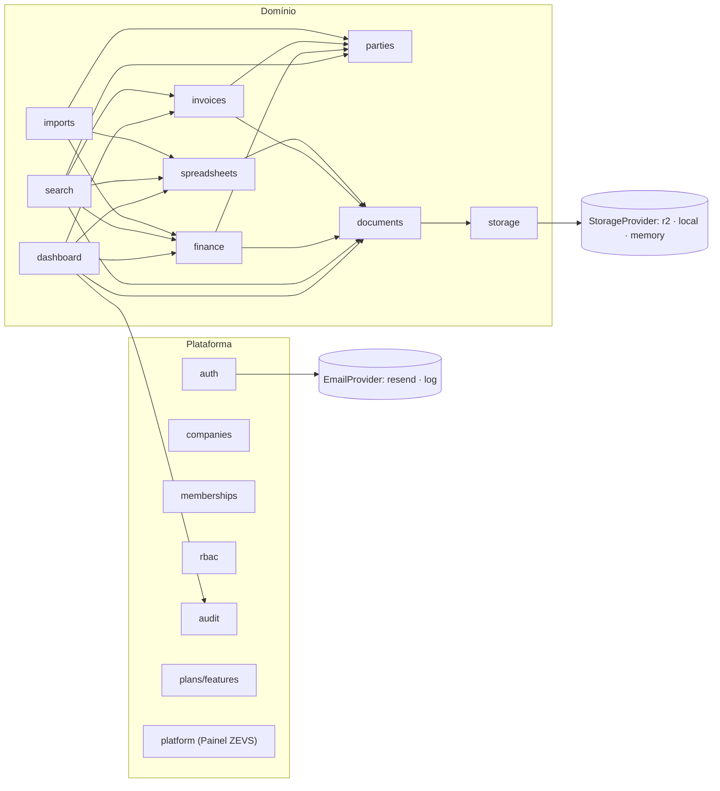
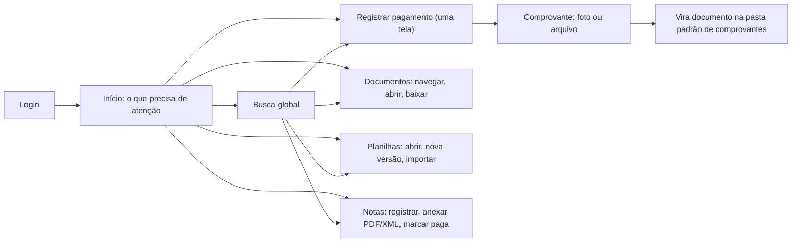

# ZEVS Nexus — Fase 0

> **Status:** ✅ **aprovada por Juan em 09/10/2026** (D1–D13 conforme as recomendações) · **Data da proposta:** 08/10/2026
>
> **ZEVS Nexus — Central de Organização Empresarial.** Robusto por dentro. Simples por fora.

### Registro da aprovação (09/10/2026)

As decisões D1–D13 foram aprovadas conforme as recomendações. Nas perguntas com mais de uma opção, vale a recomendada:

| Pergunta | Resultado |
|---|---|
| D4.2 · Nome | UI "Prestadores e fornecedores" (menu "Prestadores"); código `parties` |
| D4.3 · Despesa sem prestador | Permitida |
| D5.3 · Validade do documento | Adotada (`expires_on` opcional, alerta no Início) — entra na F3 |
| D7.2 · "Finalizada" | Emitida **e** paga (calculada). Pode ser revista na F7 com o cliente |
| D12 a–f | Adotados; g não adotado |
| D11 · Tags em despesas | Adotadas (11/10/2026, início da F4): mesmas tags da empresa, filtro e total por tag |
| D12f · Backup dos arquivos | GitHub Action diária com `rclone copy` para um bucket de backup (11/10/2026, início da F5) |
| D13.2 · Domínio | **`zevsnexus.com.br`** (11/10/2026): registrado no Registro.br, DNS no Cloudflare; e-mail pelo Resend com o domínio verificado. Tudo continua parametrizado por `APP_URL` |
| D13.3 · Banco de produção | **Neon** em vez do Postgres pago do Render (11/10/2026, decisão do Juan): conexão direta, AWS us-east-1, health check do Render em `/health` para o banco poder suspender. Plano gratuito no começo, pago quando houver uso real |
| D6.4 · Planilhas reais | Ainda não recebidas (11/10/2026): a F6 usa planilhas **fictícias** salvas pelo Excel e pelo LibreOffice (`fixtures/planilhas/`); as reais entram nos testes quando chegarem |
| D6 · Biblioteca de leitura | Leitor próprio (zip com teto + `saxes`) para XLSX e ODS e CSV próprio (11/10/2026, início da F6) |
| D7.3 · Notas recebidas | Só notas **emitidas** no MVP (11/10/2026, início da F7). A recebida continua como documento da despesa; `direction` já aceita `received` |
| D7.4 · Tipos de nota | NFS-e (padrão do formulário), NF-e e Outro, para qualquer empresa (11/10/2026, início da F7) |
| D7.2 · "Finalizada" (revisão) | Como só nota emitida pode ser paga, "Pagas" e "Finalizadas" coincidem: **uma aba "Pagas"**, e a nota paga leva o selo "Finalizada" (11/10/2026, início da F7) |

Pendentes de informação do cliente, decididos na fase em que entram:

| Pergunta | Fase |
|---|---|
| — | Nenhuma pendente no momento |

Este documento é o resultado da Fase 0 (§39 do prompt oficial). O que precisa do seu ok está na **§6 (D1–D13)**. O detalhamento técnico está em [`docs/ARCHITECTURE.md`](ARCHITECTURE.md) e as regras de trabalho do Claude estão em [`CLAUDE.md`](../CLAUDE.md). Os dois são rascunhos e passam a valer como fonte da verdade depois da aprovação.

## Onde está cada entregável da Fase 0

| # | Entregável | Onde |
|---|---|---|
| 1 | Entendimento do domínio | §2 |
| 2 | Entidades | §3 |
| 3 | Mapa de módulos | §4 |
| 4 | Fluxo principal | §5 |
| 5 | Decisões D1–D13 | §6 |
| 6 | Core adotado | §7 |
| 7 | Conditional adotado (e não adotado) | §8 e §9 |
| 8 | Plano de fases | §10 |
| 9 | Arquitetura proposta | ARCHITECTURE §1–§5 e §17–§18 |
| 10 | Modelo de banco conceitual | ARCHITECTURE §9 |
| 11 | Estratégia de armazenamento | ARCHITECTURE §10 |
| 12 | Estratégia de planilhas | ARCHITECTURE §13 |
| 13 | Estratégia de documentos | ARCHITECTURE §11 |
| 14 | Estratégia de notas | ARCHITECTURE §14 |
| 15 | Estratégia PWA | ARCHITECTURE §19 |
| 16 | Estratégia de segurança | ARCHITECTURE §20–§21 |
| 17 | Estratégia de testes | ARCHITECTURE §23 |
| 18 | Rascunho do `CLAUDE.md` | [`CLAUDE.md`](../CLAUDE.md) |
| 19 | Rascunho do `docs/ARCHITECTURE.md` | [`docs/ARCHITECTURE.md`](ARCHITECTURE.md) |

---

## 0. Fontes analisadas

- **ZEVS STRUCTURE** (Notion), versão de 03/10/2026, lida integralmente: páginas 00 a 23, *Padrões visuais*, *Projetos* (a ficha do Wash serviu de modelo), banco **ADRs** (ADR-001 a ADR-016) e banco **Matriz de padrões**.
- **Workspace** `C:\Zevs_Nexus`: vazio e sem repositório git. Não há código, configuração nem documento anterior a respeitar.

---

## 1. Divergências entre o prompt e a ZEVS STRUCTURE

Antes das decisões, estes são os pontos em que o prompt e a STRUCTURE não batem. Não resolvi nenhum deles em silêncio.

| # | Ponto | O prompt diz | A STRUCTURE diz | Como tratei |
|---|---|---|---|---|
| 1 | Numeração das páginas | 15 Testes, 16 Infra, 17 Receita | 15 Jobs · 16 Performance · 17 Testes · 18 Infra · 19 Confiabilidade · 20 Git · 21 IA · 22 Princípios/ADRs · 23 Receita. A página 11 chama-se "Web, PWA e offline" | Li todas as páginas e uso a numeração atual |
| 2 | Playwright | Faz parte do stack de testes | `Conditional` · **Proposed** (não implementado em nenhum ZEVS) | Não adotei automaticamente. Vai para aprovação explícita em **D12** |
| 3 | Outbox/notificações | Conditional | Outbox transacional é **Proposed** | Não adotado. E-mail sai assíncrono, fora da requisição (padrão Approved) |
| 4 | Importação com prévia | Estratégica | "Importação em massa com prévia e commit transacional" é **Proposed** (pág. 16) | Como é pedido explícito do projeto, vai para aprovação em **D12** |
| 5 | Backup/restore | Core | Backup externo diário: Approved. Restore testado e RPO/RTO: **Proposed**. Backup de **arquivos**: não existe na STRUCTURE | Aprovação explícita em **D12** |
| 6 | Armazenamento | "Avaliar Cloudinary / S3" | Cloudinary é `Conditional` Approved **para imagens** (allowlist jpg/png/webp, guarda só a URL). S3-compatível não existe na STRUCTURE | **D5** recomenda Cloudflare R2. O padrão nasceria Experimental |
| 7 | API versionada | `/api/v1` | Os projetos usam `/api/*` sem versão. Nenhum ADR proíbe versionar | Adotado como decisão do projeto. `/health`, `/ready` e `/api/version` ficam fora da versão. O cookie de refresh passa a usar `Path=/api/v1/auth` |
| 8 | Verbo das permissões | `finance.view` | Formato `recurso.ação`; os exemplos usam `.read` | O formato vem da STRUCTURE, o verbo não. Mantive `.view` / `.manage`, como você pediu |
| 9 | Nome "Notas" | `notes.view`, módulo Notas | — | "notes" se confunde com anotações e com as colunas `notes` (observações). No código: `invoices` / `invoices.*`. Na UI: "Notas fiscais" (rótulo curto "Notas") |
| 10 | Ordem das fases | Financeiro (3) antes de Documentos (4); Admin ZEVS na fase 10 | A Receita (23) põe Empresa e Plataforma na fundação | O comprovante do pagamento depende do armazenamento, e empresa `pending` precisa de alguém para aprovar. A §10 reordena |
| 11 | RLS | "Apenas se Core ou Conditional justificado" | RLS é `Conditional` · Experimental; ADR-006 está Proposed | **D2**: preparar desde já com `withTenant` e decidir ligar no hardening |
| 12 | Status de notas | Uma lista de 7 status | — | A lista mistura três dimensões: ciclo do documento, recebimento e arquivamento. Ver **D7** |
| 13 | Status `overdue` | Candidato a status | Datas no fuso da empresa (pág. 07) | "Vencida" é calculada, não gravada. Ver **D4** |

---

## 2. Entendimento do domínio

### O problema

Uma empresa pequena ou média, começando por uma empresa de engenharia civil, guarda a vida administrativa em lugares desconexos: pastas no computador, planilhas Excel, PDFs, notas fiscais, comprovantes, documentos e anotações de pagamentos. A informação existe, mas falta **encontrar**, **saber o que precisa de atenção** e **confiar que está tudo junto**.

### O que o Nexus é — e o que não é

O Nexus é um **sistema de registro e organização**, não um sistema de execução:

- **não paga:** registra pagamentos feitos fora dele (PIX, boleto, transferência);
- **não emite notas:** organiza as notas emitidas por outro sistema;
- **não concilia nem movimenta saldo:** não há conta bancária, caixa nem livro-razão.

Daí saem três consequências de arquitetura:

1. Não há webhooks, gateways nem integrações que movimentam dinheiro.
2. A integridade financeira é **consistência dos registros e auditoria**, e não reconciliação de saldo. O livro-caixa (ADR-013) fica de fora.
3. O valor central está em **arquivos bem organizados e encontráveis**, e por isso Documentos é o núcleo.

### Situações reais que o sistema precisa resolver

| Situação | Resposta do Nexus |
|---|---|
| "Paguei o pedreiro hoje por PIX" | No celular, uma tela: valor, prestador, data, método e foto do comprovante. Menos de 30 s |
| "O que vence esta semana? O que está atrasado?" | O dashboard mostra isso ao abrir |
| "Cadê o comprovante do eletricista / o contrato / a nota de setembro?" | Busca global por nome, especialidade, número ou descrição |
| "A planilha de controle que estou usando" | Planilhas › Em uso, com a versão atual e as anteriores |
| "Essa nota já foi paga?" | Notas › Pendentes |
| "Preciso mandar o cartão CNPJ / uma certidão" | Documentos › Empresa › baixar |

### Glossário (UI × conceito × código)

| UI (PT-BR) | Conceito | Código |
|---|---|---|
| Empresa | Tenant | `companies` |
| Membro | Vínculo usuário × empresa, com papéis | `memberships` |
| Prestador, fornecedor, cliente | Contraparte (pessoa física ou jurídica) com um ou mais papéis | `parties` (`roles`) |
| Despesa | Obrigação de pagar: quanto, a quem, até quando | `expenses` |
| Pagamento | Baixa total ou parcial de uma despesa | `expense_payments` |
| Categoria | Classificação financeira | `finance_categories` |
| Documento | Arquivo lógico, com versões | `documents` → `document_versions` → `files` |
| Pasta | Organização hierárquica criada pela empresa | `folders` |
| Tag | Rótulo transversal | `tags` |
| Tipo de documento | A "categoria" do documento (contrato, certidão…) | `document_types` |
| Planilha | Documento de planilha com metadados próprios | `spreadsheets` |
| Importação | Conversão controlada de linhas de planilha em registros | `import_jobs`, `import_rows` |
| Nota fiscal | Nota emitida fora do Nexus e organizada aqui | `invoices` |

Identificadores ficam em inglês (como no Wash); UI, comentários e mensagens ficam em PT-BR (pág. 20).

---

## 3. Entidades

A coluna **Fase** indica quando a tabela nasce. Todas as tabelas operacionais têm `company_id` e FK composta (ADR-005).

| Grupo | Entidade | Tabela(s) | Fase | Observação |
|---|---|---|---|---|
| Identidade | Usuário e sessão | `users`, `refresh_tokens`, `password_reset_tokens`, `email_verification_tokens` | F1 | Usuário global, sem `company_id` |
| Tenant | Empresa | `companies`, `company_settings`, `company_branding`, `company_contacts`, `company_usage` | F2 | `company_usage` guarda o armazenamento consumido (cota) |
| Acesso | Vínculo e convites | `memberships`, `invitations` | F2 / F10 | Convites só na F10 |
| Acesso | RBAC | `roles`, `permissions`, `role_permissions`, `membership_roles`, `membership_permissions` | F2 | Catálogo em código + seed idempotente |
| Plataforma | SaaS | `platform_admins`, `plans`, `features`, `plan_features`, `subscriptions`, `company_features` | F2 | Sem billing no MVP |
| Suporte | Auditoria | `audit_logs` | F2 | Append-only por trigger |
| Suporte | Idempotência | `idempotency_keys` | F2 | Expira em 24 h |
| Arquivos | Objeto armazenado | `files` | F3 | Metadados do binário no storage |
| Documentos | Organização | `folders`, `documents`, `document_versions`, `document_types`, `tags`, `document_tags`, `document_favorites` | F3 | Favorito é por membro |
| Cadastros | Contraparte | `parties`, `party_documents` | F4 | Prestador, fornecedor e cliente na mesma tabela |
| Financeiro | Despesas | `finance_categories`, `expenses`, `expense_payments`, `expense_documents` | F4 | Comprovante = documento vinculado |
| Planilhas | Planilha | `spreadsheets` | F6 | Extensão 1:1 de `documents` |
| Notas | Nota fiscal | `invoices`, `invoice_documents` | F7 | PDF/XML = documentos vinculados |
| Importação | Job | `import_jobs`, `import_rows` | F9 | `expenses` ganha `source_import_id` |

**Sem associação polimórfica** (`entity_type` + `entity_id`): ela impediria a FK composta, que é Core (ADR-005). Cada vínculo tem a sua tabela: `expense_documents`, `invoice_documents`, `party_documents`. A única exceção consciente é `audit_logs`, que é registro histórico e não relação viva.

---

## 4. Mapa de módulos

Uma seta significa "usa o **service** de". Nenhum módulo importa o repository de outro (pág. 01).

| Módulo | Responsabilidade | Telas |
|---|---|---|
| `auth` | Cadastro, login, sessão, reset, verificação | Login, cadastro, recuperar/redefinir senha, verificar e-mail |
| `companies` | Dados da empresa, onboarding, configurações, cota | Onboarding, Empresa, Configurações |
| `memberships` + `rbac` | Vínculos, papéis, permissões, convites | Equipe (F10) |
| `audit` | Registro append-only, atividade recente | Atividade, histórico do documento |
| `plans` | Planos, features, limites | — (Painel ZEVS) |
| `platform` | Painel ZEVS | `/admin/*` |
| `storage` | Upload e download por URL assinada, validação, cota, limpeza | — (usado por documents) |
| `documents` | Pastas, documentos, versões, tags, tipos, favoritos, lixeira | Central de Documentos |
| `parties` | Prestadores, fornecedores e clientes | Prestadores e fornecedores |
| `finance` | Categorias, despesas, pagamentos, comprovantes | Financeiro |
| `spreadsheets` | Metadados, visões, prévia | Planilhas |
| `imports` | Nível 3: análise, mapeamento, validação, prévia, confirmação | Assistente de importação |
| `invoices` | Notas fiscais e anexos | Notas fiscais |
| `search` | Busca global por permissão | Busca, `Ctrl+K` |
| `dashboard` | Agregações por permissão | Início |

---

## 5. Fluxo principal

Meta de poucos passos, pensada para o celular:

| Ação | Caminho |
|---|---|
| Registrar pagamento já feito | Início → **+** → *Pagamento* → valor · prestador · data · método → *Tirar foto* → Salvar |
| Consultar documento | Lupa → digitar → resultado → abrir |
| Abrir planilha em uso | Mais → Planilhas → *Em uso* → baixar (ou prévia na tela) |
| Consultar nota | Notas → *Pendentes* → nota |
| Ver o que vence | Abrir o app: o bloco "A pagar" já mostra vencidas e as dos próximos 7 dias |

---

## 6. Decisões para aprovação

| D | Título | Recomendação em uma linha |
|---|---|---|
| D1 | Escopo do MVP | MVP em dois marcos. Piloto (F1–F5) com Documentos + Financeiro. MVP completo (F6–F8) com Planilhas níveis 1–2, Notas e Busca |
| D2 | Modelo multi-tenant | Core integral + `withTenant` desde a F2. Decidir ligar RLS na F10 |
| D3 | Autenticação e sessão | Pacote de sessão do Wash, sem simplificação + cadastro público com aprovação manual da empresa |
| D4 | Modelo financeiro | Despesa + pagamentos (parcial permitido); "vencida" calculada; contrapartes em `parties` |
| D5 | Documentos e armazenamento | "Um arquivo, um lugar"; Cloudflare R2 com URL pré-assinada; versionamento |
| D6 | Planilhas e importação | Visões como filtros; níveis 1–2 no MVP; nível 3 depois de ver planilhas reais, síncrono com teto |
| D7 | Notas | Separar status do documento, recebimento e arquivamento; só notas emitidas no MVP |
| D8 | Busca global | PostgreSQL trigram por metadados, filtrada por permissão; sem conteúdo de arquivos |
| D9 | PWA, cache e offline | Instalável, network-first, sem offline operacional |
| D10 | Papéis e permissões | 5 papéis, catálogo de 19 permissões, lançar ≠ pagar |
| D11 | Extensibilidade para obras | Nenhuma tabela agora; preparação pela forma do modelo; pastas e tags como ponte |
| D12 | Itens Proposed pedidos pelo projeto | Adotar Playwright, restore testado + RPO/RTO, `npm audit`, acessibilidade, importação com prévia e backup de arquivos |
| D13 | Fases, piloto e infraestrutura | 11 fases; produção paga antes do piloto (fim da F5) |

### D1 — Escopo exato do MVP

**Decisão proposta.** MVP em dois marcos:

- **MVP piloto (F1–F5):** conta e sessão, empresa, **Central de Documentos completa** (pastas, tags, tipos, favoritos, versões, histórico, lixeira), **Prestadores e fornecedores**, **Financeiro administrativo** (despesas, pagamentos, comprovantes, categorias), dashboard com pendências e **PWA instalável**. O cliente começa a usar com dados reais, em produção paga.
- **MVP completo (F6–F8):** Planilhas (níveis 1 e 2), Notas fiscais, Busca global e dashboard completo.
- **Pós-MVP (F9–F11):** importação estruturada (nível 3), equipe e convites, LGPD (exportação e anonimização), hardening e Painel ZEVS completo.
- **Fora:** emissão fiscal, ERP, contabilidade, estoque, vendas, CRM, gestão de obras, offline-first, integração bancária, push, API de WhatsApp, OCR e leitura do conteúdo de PDFs.

**Alternativas.** (a) Só liberar ao cliente depois da F8. (b) Seguir o rascunho do prompt, com Financeiro antes de Documentos.

**Recomendação.** Os dois marcos. O ADR-015 e a Receita (etapa 14) pedem "MVP no ar o quanto antes". Documentos + Financeiro resolvem a dor principal (dispersão + pagamentos), e o uso real orienta Planilhas e Notas.

**Impacto.** Produção paga é antecipada para antes do piloto (D13). Planilhas e Notas passam a ser desenhadas com feedback real.

**Pergunta para aprovação.** Aprova o MVP em dois marcos, com o piloto após a F5 (Documentos + Financeiro) e a importação estruturada fora do MVP?

### D2 — Modelo multi-tenant

**Decisão proposta.** Core integral da página 03 e dos ADRs 002 a 005:

- banco e schema compartilhados, com `company_id`; tenant = empresa;
- `X-Company-Id` validado contra membership **ativa** em empresa **ativa**;
- `tenantRouter()` com guarda estática nos testes;
- repository escopado (`companyId` como 1º argumento, helper `scopedTable`);
- FK composta em todas as relações internas e unique `(company_id, id)` nas tabelas pai;
- **404 idêntico** para recurso de outro tenant;
- `company_id` no body é recusado pelo `.strict()`;
- mutação só depois de `SELECT … AND company_id = $2 FOR UPDATE`;
- suíte A × B **por módulo**, incluindo arquivos, URLs assinadas e busca.

No armazenamento, a chave `companies/<company_id>/files/<file_id>` é gerada só pelo servidor.

Sobre **RLS**: toda transação de tenant passa por `withTenant()` desde a F2, já setando `app.company_id`. Ligar as policies fica para a F10, por migration.

**Alternativas.** (a) RLS ligado desde o primeiro commit. (b) Nunca RLS. (c) Schema por tenant (rejeitado pelo ADR-002).

**Recomendação.** Preparar agora e ligar na F10. O gatilho que a STRUCTURE dá para RLS é "dados sensíveis", e o Nexus guarda contratos, notas e comprovantes. O Nexus seria o 2º projeto a validar o padrão (o Wash tem um protótipo).

**Impacto.** Custo baixo agora. Na F10, ligar RLS vira uma migration mais a suíte de testes.

**Pergunta para aprovação.** Aprova Core integral + `withTenant` desde a F2, com a decisão de ligar RLS na F10?

### D3 — Autenticação e sessão

**Decisão proposta.** Pacote do Wash (pág. 04, ADR-007), sem simplificação por ser um usuário só:

- bcryptjs custo 12; senha de 8 a 72 bytes (recusada, não truncada), com a regra visível;
- JWT HS256 de 15 min, só em memória, `{ sub, aud, jti }`, sem papel e sem tenant;
- refresh opaco de 48 bytes, guardado como hash SHA-256, em cookie `__Secure-` `HttpOnly; Secure; SameSite=Strict; Path=/api/v1/auth`; 7 dias deslizantes, com teto de 30;
- rotação a cada uso; reuso revoga a família e manda e-mail de alerta;
- guarda CSRF (`X-ZN-CSRF: 1` + `Origin` na allowlist + `Sec-Fetch-Site`);
- Web Locks e `BroadcastChannel` entre abas;
- login sem enumeração;
- reset de uso único (1 h) que derruba as sessões; troca de senha que exige a atual;
- verificação de e-mail (7 dias), **obrigatória para ativar a empresa**;
- tokens removidos da URL; "sair de todos os dispositivos".

**Entrada de clientes:** cadastro público → onboarding cria a empresa como `pending` → o Platform Admin aprova (`Conditional` Approved). A justificativa: cada empresa consome armazenamento pago e a venda é consultiva.

**Não adotado:** lockout de conta (`Conditional` do Vale), porque o rate limit por IP + e-mail cobre. 2FA não existe na STRUCTURE; fica como candidato futuro, dado o tipo de dado guardado.

**Alternativas.** (a) Só convite: o Platform Admin cria a empresa e convida o dono. (b) Cadastro aberto sem aprovação.

**Recomendação.** A proposta, que reaproveita só padrões Approved e um único caminho de entrada.

**Impacto.** Painel ZEVS mínimo (aprovar empresa) já na F2.

**Pergunta para aprovação.** Aprova o pacote de sessão do Wash e o cadastro público com aprovação manual da empresa?

### D4 — Modelo financeiro inicial

**Decisão proposta.**

- **Despesa** (`expenses`) é a obrigação: descrição, prestador (opcional), categoria, valor, vencimento, observações.
- **Pagamento** (`expense_payments`) é cada baixa efetiva: data, valor, método, referência e comprovante. Uma despesa aceita **1..N pagamentos** (parcial permitido).
- **Status gravados:** `pending` (pendente) · `scheduled` (agendado, com `scheduled_for`) · `partially_paid` · `paid` · `cancelled`.
- **"Vencida" é calculada:** vencimento < hoje **no fuso da empresa** e despesa não quitada. Nunca é gravada, então não há job para "virar" status.
- `paid_amount_cents` só muda por uma função, com `FOR UPDATE` (padrão Core "saldo derivado"). A soma dos pagamentos nunca passa do valor.
- **Pagamento não se edita.** Correção = estornar (com motivo, auditado) e lançar outro.
- **Atalho "Já paguei":** cria despesa + pagamento numa requisição. É o caso mais comum do cliente.
- Centavos em `bigint`. Métodos: `pix`, `boleto`, `transfer`, `cash`, `card`, `check`, `other`.
- Categorias com `kind` (`expense` | `income`) desde já, criadas no onboarding como **lista genérica editável**, não de engenharia.
- **Contrapartes:** tabela `parties` (pessoa física ou jurídica, CPF/CNPJ validado, `roles` = `supplier` / `service_provider` / `customer`, `specialty` livre como "Eletricista" ou "Pedreiro", contato, chave PIX, observações). "Pedreiro" vira dado, nunca módulo. Os tomadores das notas usam a mesma tabela.

**Definições de indicador** (pág. 12 exige a definição por escrito):

- *A pagar vencido* = saldo em aberto das despesas não quitadas com vencimento < hoje.
- *Vence em 7 dias* = mesmo cálculo, para vencimento de hoje a hoje + 7.
- *Pago no período* = soma dos pagamentos não estornados com data no período (regime de caixa).
- *Despesas do período* = soma das despesas não canceladas com vencimento no período.

**Alternativas.** (a) Lançamento único com o pagamento embutido: mais simples, mas sem pagamento parcial. (b) Título genérico pagar/receber com `direction`: desenho de ERP. (c) Livro-caixa (ADR-013): o Nexus não guarda dinheiro.

**Recomendação.** A proposta.

**Impacto.** Contas a receber viram `receivables`, no mesmo desenho, reaproveitando `parties` e categorias. O fluxo de caixa é a união de pagamentos e recebimentos. Recorrência entra como `recurrence_id`, e centro de custo ou obra como FK nullable, por migration.

**Perguntas para aprovação.**
1. Aprova despesa + pagamentos (com parcial), os 5 status e a "vencida" calculada?
2. Na UI, "Prestadores e fornecedores" (menu: "Prestadores"); no código, `parties`?
3. Despesa pode existir sem prestador (ex.: tarifa bancária)? Recomendo que sim.

### D5 — Modelo de documentos e armazenamento

**Decisão proposta.**

- **"Um arquivo, um lugar."** Todo arquivo do sistema é um `document`: comprovante, PDF/XML de nota, planilha, contrato. Financeiro, Notas e Planilhas **vinculam** documentos; não guardam arquivos próprios. A busca e a Central de Documentos enxergam tudo.
- **Organização:**
  - pastas e subpastas criadas pela empresa; no onboarding são sugeridas, como dado editável: Empresa · Financeiro › Comprovantes · Notas fiscais · Planilhas · Contratos · Prestadores · Outros;
  - tags;
  - **tipo de documento**, que é a "categoria", numa lista configurável;
  - favoritos por pessoa, arquivados, lixeira (soft delete) e histórico (auditoria + versões).
- **Versionamento:** novo upload no mesmo documento = nova versão. Restaurar = nova versão apontando para o arquivo antigo. Versões nunca são editadas.
- **StorageProvider** (Core provider/adapter):
  - `r2` (Cloudflare R2, S3-compatível) em staging e produção;
  - `local` (disco + URL assinada por HMAC, só dev);
  - `memory` (testes);
  - o boot falha em produção com provider `local`.
- **Upload direto do navegador com assinatura do backend** (padrão Approved): pedido de upload → URL `PUT` pré-assinada (10 min, `Content-Type` e `Content-Length` assinados) → confirmação (`HEAD` + magic bytes + cota atômica).
- **Download:** endpoint autorizado devolve URL `GET` pré-assinada de 60 s, com `attachment` (inline só para PDF e imagem). O download é auditado.
- **Limites:** allowlist `pdf, xml, xlsx, xls, csv, ods, docx, doc, odt, txt, jpg, jpeg, png, webp`. Bloqueados: executáveis, scripts, HTML, SVG, arquivos com macro (`xlsm`, `docm`) e compactados. Até **25 MB** por arquivo e cota de armazenamento por plano.
- **Sugestão (não pedida):** campo opcional **validade** (`expires_on`) no documento, para certidões, alvarás e contratos, com alerta no dashboard. É genérico e custa pouco.

**Alternativas de storage.**
- **Cloudinary:** é Approved, mas para imagens. O padrão aprovado guarda URL de entrega, e em contas gratuitas a entrega de PDF pode exigir liberação explícita. Não é desenhado para documentos privados.
- **AWS S3:** cobra egress.
- **Disco do Render:** não pode ser fonte da verdade (o prompt também veda).
- **`bytea` no PostgreSQL:** incha o banco e os backups.
- **Upload passando pelo servidor:** mais simples de validar, mas contraria o padrão Approved e consome banda do Render.

**Recomendação.** R2 com fluxo direto. O bucket é privado por padrão, não cobra egress, a conta Cloudflare já é Core, e as URLs assinadas são curtas e servidas **de outro domínio**, o que isola o app de conteúdo enviado.

**Impacto.** A CSP inclui o endpoint do R2 em `connect-src` e `img-src`. O padrão nasce Experimental e deve entrar na ficha. O backup de arquivos passa a ser necessário (D12).

**Perguntas para aprovação.**
1. Aprova o R2 como storage?
2. Aprova "um arquivo, um lugar"?
3. Quer o campo de validade do documento?
4. Formatos e limite de 25 MB estão bons?

### D6 — Modelo de planilhas e importação

**Decisão proposta.**

- **Planilha = documento** de tipo planilha (`xlsx`, `xls`, `csv`, `ods`), registrado automaticamente em `spreadsheets` com `in_use` e `reference_year`. O ano de referência é sugerido pela data de modificação do arquivo e pode ser editado.
- **As visões são filtros, não pastas.** Uma planilha pode estar em "Em uso" e "Deste ano" ao mesmo tempo:

  | Visão | Regra |
  |---|---|
  | Em uso | `in_use = true` |
  | Deste ano | `reference_year` = ano atual (fuso da empresa) |
  | Antigas | `reference_year` < ano atual e não arquivada |
  | Arquivadas | documento com `archived_at` |
  | Importadas | tem importação concluída |

- **Nível 1 (F6):** armazenar, versionar, buscar, filtrar e baixar.
- **Nível 2 (F6):** prévia somente leitura (abas, linhas paginadas) de XLSX, CSV e ODS. **XLS legado só para download**: a biblioteca que lê XLS no npm (`xlsx` 0.18.5) tem CVEs conhecidos, e as versões corrigidas ficam fora do npm. Fórmulas nunca são avaliadas; a prévia mostra o valor calculado salvo no arquivo.
- **Nível 3 (F9, feature `spreadsheet_import`):**
  - pipeline: upload → análise → mapeamento → validação → prévia → confirmação → processamento → resultado → relatório de erros;
  - destino inicial único: **despesas/pagamentos**;
  - **só cria**: nunca atualiza nem exclui registros ausentes da planilha;
  - duplicidade: hash do arquivo (aviso) e linha "possivelmente duplicada" (mesmo prestador + valor + vencimento); quem decide é o usuário;
  - confirmação com `Idempotency-Key` + máquina de estados (só uma confirmação vence);
  - transação única, até **5.000 linhas** por importação;
  - todo registro criado guarda a importação e a linha de origem;
  - **"Desfazer importação"**: soft delete do que não foi alterado depois;
  - relatório de erros em CSV com proteção contra fórmula.
- **Síncrono com teto, sem fila.** 5.000 linhas cabem com folga no timeout de 100 s do Cloudflare. O `import_job` já tem forma de job: se o volume real exigir, troca-se o executor para job in-process (Approved) sem mudar o modelo.
- A **biblioteca de leitura** é escolhida na F6, testada contra as planilhas reais, e registrada como decisão.

**Alternativas.** (a) Converter automaticamente no upload: rejeitado, porque promete o que ainda não conhecemos. (b) Fila ou worker desde já: Proposed. (c) Ficar só no nível 1.

**Recomendação.** A proposta. É o seu próprio princípio: primeiro organizar e visualizar, depois converter mediante mapeamento e validação.

**Impacto.** O nível 3 depende de exemplos reais e fica fora do MVP.

**Perguntas para aprovação.**
1. Aprova as visões como filtros (`in_use` / `reference_year`)?
2. Aprova o nível 3 na F9, só para despesas e pagamentos?
3. Aprova o processamento síncrono com teto de 5.000 linhas?
4. Pode me mandar de 3 a 5 planilhas reais (anonimizadas) antes da F6?

### D7 — Modelo de notas

**Decisão proposta.**

- Tabela `invoices` (UI "Notas fiscais"). No MVP, só **notas emitidas pela empresa**. Notas **recebidas** de fornecedores entram como documento vinculado à despesa (tipo "Nota fiscal recebida"). A coluna `direction` já aceita `issued` / `received`, para não reescrever depois, mas a UI expõe só emitidas.
- **Separar as três dimensões que a lista original mistura:**
  - `status` (ciclo do documento): `processing` → `issued` → `cancelled`;
  - `payment_status` (recebimento): `pending` → `paid`;
  - `archived_at` (arquivamento).

  | Rótulo pedido | Regra |
  |---|---|
  | Em processamento | `status = processing` |
  | Emitidas | `status = issued` |
  | Pendentes | emitida e `payment_status = pending` |
  | Pagas | `payment_status = paid` |
  | Finalizadas | emitida **e** paga (calculada) |
  | Canceladas | `status = cancelled` |
  | Arquivadas | `archived_at` preenchido |

- **Campos:** tipo (NFS-e, NF-e, outro), número, série, emissão, competência, tomador (`parties` com papel cliente), descrição, valor bruto, retenções (total), valor líquido (calculado), vencimento, data e valor recebido, código de verificação/chave, observações.
- **Anexos:** PDF, XML e comprovante, como documentos vinculados.
- **Regras:**
  - emitida exige número e data;
  - cancelada não pode ser marcada paga;
  - desmarcar "paga" é auditado;
  - número único por (empresa, tipo, série, número).
- **XML só armazenado no MVP.** Preencher a nota lendo o XML (com parser sem DTD e sem entidades externas) fica para depois de ver XMLs reais. Sem integração fiscal: o ADR-014 só entra por decisão futura explícita.

**Alternativas.** (a) Um status único com 7 valores. Rejeitado: "paga" e "emitida" não são exclusivas, e isso criaria combinações impossíveis. (b) Ler o XML já no MVP.

**Recomendação.** A proposta.

**Impacto.** Contas a receber futuras se ligam à nota sem migração de status.

**Perguntas para aprovação.**
1. Aprova status, recebimento e arquivamento separados?
2. "Finalizada" é "emitida e paga", ou é outra etapa (ex.: impostos e retenções conferidos)?
3. Só notas emitidas no MVP?
4. Quais tipos o cliente emite (NFS-e?)

### D8 — Busca global

**Decisão proposta.**

- PostgreSQL com `pg_trgm` + `unaccent` (`Conditional` Approved, Wash): coluna gerada `search_text` normalizada e índice GIN trigram por empresa.
- Endpoint único `GET /api/v1/search?q=`, montado como `UNION ALL` de uma consulta por módulo. **Cada consulta só entra se a pessoa tem o `*.view` daquele módulo** (regra de LGPD da pág. 06).
- Resultados agrupados por tipo e ranqueados por similaridade e recência, a partir de 2 caracteres.
- **Escopo:** documentos (título, nome do arquivo, descrição, tags, pasta), planilhas, notas (número, tomador, descrição), despesas (descrição, prestador, categoria), prestadores (nome, especialidade, CPF/CNPJ, telefone) e contatos da empresa.
- "eletricista" encontra o prestador pela especialidade e, a partir dele, os pagamentos, comprovantes e documentos vinculados.
- **UI:** campo no cabeçalho (desktop), lupa (celular) e `Ctrl+K` / `/` (`Conditional` Approved).
- **Fora do MVP:** conteúdo de PDFs e células de planilhas.

**Alternativas.** (a) Tabela-índice unificada sincronizada por trigger: mais um ponto de falha. (b) Full-text `tsvector`: pior para nomes, trechos parciais e erro de digitação. (c) Meilisearch ou Typesense: mais um serviço, com dados fora do PostgreSQL.

**Recomendação.** A proposta: nenhum serviço novo, só padrões já usados.

**Impacto.** Cada módulo novo (ex.: obras) entra na busca acrescentando a sua consulta.

**Pergunta para aprovação.** Aprova a busca em PostgreSQL por metadados, sem conteúdo de arquivos no MVP?

### D9 — PWA, cache e offline

**Decisão proposta.**

- **PWA = sim** (`Conditional`, justificado pelo uso no celular).
- **Estratégia de atualização Core desde a F1:** `/api/version`, versão carimbada no HTML, `update-checker` e banner "Nova versão → Atualizar".
- **Manifest único "ZEVS Nexus":** o app é o mesmo para todas as empresas, no mesmo domínio, então manifest por tenant não se justifica.
- Ícones PNG + `apple-touch-icon`.
- **Service worker network-first** só para o shell. `/api/*` e URLs de arquivos **nunca** vão para cache.
- **Offline:** só a tela "Sem conexão", com "Tentar de novo". Sem fila offline, sem SQLite local, sem PowerSync/RxDB (Project-specific do Market).
- Câmera via `<input capture>` para comprovantes.
- Sem push e sem banner de instalação (Experimental). Em Configurações, uma ajuda "Como instalar".

**Alternativas.** (a) Offline-first: rejeitado. (b) Sem service worker: não instala no Android.

**Recomendação.** A proposta.

**Impacto.** A PWA entra na F5, antes do piloto, para o cliente instalar no celular.

**Pergunta para aprovação.** Aprova PWA instalável, sem offline operacional?

### D10 — Papéis e permissões

**Decisão proposta.** Catálogo em código + seed (pág. 05), resolvido por requisição. Permissões efetivas = (papéis ∪ grants) − denies.

| Permissão | Owner | Admin | Financeiro | Assistente | Visualização |
|---|:-:|:-:|:-:|:-:|:-:|
| `dashboard.view` | ✓ | ✓ | ✓ | ✓ | ✓ |
| `company.view` | ✓ | ✓ | ✓ | ✓ | ✓ |
| `company.manage` | ✓ | ✓ | | | |
| `settings.manage` | ✓ | ✓ | | | |
| `users.manage` | ✓ | ✓ | | | |
| `parties.view` | ✓ | ✓ | ✓ | ✓ | ✓ |
| `parties.manage` | ✓ | ✓ | ✓ | ✓ | |
| `finance.view` | ✓ | ✓ | ✓ | ✓ | ✓ |
| `finance.manage` (lançar/editar despesa) | ✓ | ✓ | ✓ | ✓ | |
| `finance.pay` (registrar/estornar pagamento) | ✓ | ✓ | ✓ | | |
| `documents.view` | ✓ | ✓ | ✓ | ✓ | ✓ |
| `documents.manage` | ✓ | ✓ | ✓ | ✓ | |
| `spreadsheets.view` | ✓ | ✓ | ✓ | ✓ | ✓ |
| `spreadsheets.manage` | ✓ | ✓ | ✓ | ✓ | |
| `spreadsheets.import` (+ exige `finance.manage`) | ✓ | ✓ | ✓ | | |
| `invoices.view` | ✓ | ✓ | ✓ | ✓ | ✓ |
| `invoices.manage` | ✓ | ✓ | ✓ | ✓ | |
| `audit.view` | ✓ | ✓ | | | |
| `data.export` | ✓ | ✓ | ✓ | | |

- **Anti-escalada** (5 regras do Wash): `CANNOT_CHANGE_SELF`, `PRIVILEGE_ESCALATION`, `OWNER_PROTECTED`/`TARGET_OUTRANKS`, `LAST_OWNER`, e trava + auditoria na mesma transação.
- **Sem `finance.view`:** o backend **omite** valores no dashboard e na busca.
- **Owner × Admin:** hoje diferem só pela proteção de dono. `subscription.manage` entra quando houver billing.
- **Fora:** `reports.view` (não há módulo de relatórios; os blocos do dashboard usam as permissões dos módulos), `notes.*` (virou `invoices.*`) e permissão por pasta (futuro).

**Alternativas.** (a) Só `view` / `manage` por módulo, sem separar lançar de pagar. (b) Papéis fixos sem grant/deny.

**Recomendação.** A proposta. Separar quem lança de quem dá baixa é o controle administrativo mínimo quando houver equipe.

**Impacto.** O primeiro usuário é owner e não percebe nada disso. A equipe chega na F10 sem refatoração.

**Pergunta para aprovação.** Aprova os 5 papéis, o catálogo e a separação lançar (`finance.manage`) × pagar (`finance.pay`)?

### D11 — Extensibilidade para projetos/obras

**Decisão proposta.** Nenhuma tabela de projeto ou obra agora. A preparação está na forma do modelo:

1. Toda entidade operacional tem `(company_id, id)` único. A obra futura entra com FK composta nullable (`project_id`) em despesas, notas e documentos, ou com tabelas de vínculo, por migration, na fase do módulo.
2. `parties.roles` já inclui `customer` (o cliente da obra).
3. Categorias têm `kind`. Centro de custo será uma dimensão própria.
4. Busca e dashboard são compostos por módulo: um módulo novo pluga a sua consulta e o seu bloco sem mexer nos outros.
5. Uma feature `projects` liga o módulo por empresa ou plano.
6. **Ponte que funciona já:** o cliente organiza por obra com pastas (Documentos › Obras › Residencial X) e tags. Depois, uma migração pode converter tags em obras.

**Alternativas.** (a) Criar tabelas de projeto vazias agora: o prompt veda (§15). (b) Colunas `project_id` sem tabela: impossível manter com FK.

**Recomendação.** A proposta. **Opcional:** tags também em **despesas** ("Obra Residencial X"), o que dá custo por obra antes do módulo existir. É genérico: serve para "Filial", "Evento" etc.

**Impacto.** Zero entidade especulativa.

**Pergunta para aprovação.** Aprova a estratégia? Quer tags em despesas já na F4 (se hoje o cliente controla custo por obra)?

### D12 — Itens Proposed que este projeto pede

A STRUCTURE manda não adotar Proposed automaticamente. O prompt pede estes itens de forma explícita, então cada um precisa do seu ok:

| Item | Status na STRUCTURE | Recomendação |
|---|---|---|
| **a. E2E com Playwright** | `Conditional` · Proposed | Adotar. Smoke de login na F1, o fluxo cresce a cada fase, E2E completo na F10. O Nexus seria o 1º projeto a implementar (→ Experimental) |
| **b. Restore testado + RPO/RTO** | Core · Proposed | Adotar. **RPO 24 h / RTO 8 h** no MVP; ensaio de restore antes do piloto e a cada trimestre, registrado |
| **c. `npm audit` / Dependabot no CI** | Core · Proposed | Adotar. Ler arquivos de terceiros (planilhas, XML) aumenta o risco de dependências |
| **d. Acessibilidade** | Proposed | Adotar como item do Definition of Done: labels, foco visível, contraste, `aria-hidden` nos ícones, alvos de 44 px |
| **e. Importação com prévia e commit transacional** | Proposed (pág. 16) | Adotar, como descrito em D6, sem `COPY` (5.000 linhas em lotes de `INSERT`) |
| **f. Backup dos arquivos** | Não existe | Adotar. Cópia diária dos objetos novos para um segundo bucket + exclusão física só depois da retenção. Implementação definida na F5 |
| g. Outbox, fila/worker, advisory lock, circuit breaker, métricas e alertas | Proposed | **Não adotar** |

**Pergunta para aprovação.** Aprova os itens **a** a **f**?

### D13 — Plano de fases, piloto e infraestrutura

**Decisão proposta.**

- Plano de **11 fases** (§10).
- **Staging** a partir da F2: Render free + Postgres gratuito.
- **Produção paga antes do piloto (fim da F5):** Render Starter (web) + Render Postgres pago, região Virginia; R2 de produção; Resend com domínio verificado; Cloudflare com segredo de origem e WAF; backup diário externo; restore testado. É Core ("produção em plano pago"), porque o plano free hiberna e o Postgres free expira.

**Alternativas.** (a) Piloto em plano free: viola o Core e arrisca dados reais do cliente. (b) Adiar o piloto para depois da F8.

**Recomendação.** A proposta.

**Impacto.** Custo mensal de infraestrutura começa no fim da F5.

**Perguntas para aprovação.**
1. Aprova o plano e o custo antecipado?
2. Qual domínio? Sugestão: `nexus.zevs.tec.br` (o Store já usa `zevs.tec.br`).

---

## 7. Regras Core adotadas

Toda regra Core da STRUCTURE foi adotada. **Não há exceção proposta.**

| Regra | Origem | Motivo no Nexus | Impacto | Módulo |
|---|---|---|---|---|
| Monólito modular, serviço único API + SPA | 01 · ADR-001 | Um dev, custo baixo, mesma origem para cookies | Um deploy, um banco | Todos |
| Camadas routes → controller → service → repository; arquivos por módulo | 01 | SQL só no repository; regra só no service | Estrutura fixa por módulo | Backend |
| `createApp()` separado de `server.js` | 01 | Testes com Supertest sem `listen` | — | Backend |
| Backend é a fonte da verdade | 01 · Princípio 1 | Status, valores, vencida, cota e permissões calculados no servidor | O front só apresenta | Todos |
| Configuração em vez de `if (empresa)` | 01 · Princípio 9 | Engenharia é só o 1º contexto | Pastas, categorias e tipos são dados do tenant | Todos |
| Provider/adapter para o que é externo | 01 · 14 · Princípio 6 | Trocar R2 ou Resend sem tocar o core | `StorageProvider`, `EmailProvider` | storage, auth |
| Módulo fala com outro só pelo service | 01 | Finance anexa comprovante via `documents.service` | Fronteiras explícitas | Todos |
| Stack backend: Node 24 LTS ESM, Express 5, `pg` sem ORM, node-pg-migrate 9, Zod 4, jsonwebtoken + bcryptjs, helmet, cors, express-rate-limit, cookie-parser, pino | 02 · ADR-008 | Padrão ZEVS | Sem ORM | Backend |
| Stack frontend: HTML + ESM sem framework e sem bundler, Tailwind v4 compilado, sprite Lucide no build, Chart.js vendorizado | 02 · ADR-009/010 | CSP sem `unsafe-inline` | Build só de CSS e ícones | Frontend |
| Jest + Supertest, ESLint 9; GitHub Actions, Render, Cloudflare, Resend, uptime externo | 02 | Padrão ZEVS | CI desde a F1 | Infra |
| Tenant resolvido no servidor (`X-Company-Id` + membership) | 03 · ADR-003 | Nunca confiar no front | Uma query de membership por request | Todos |
| `tenantRouter()` + guarda estática | 03 | Rota nova nunca nasce sem tenant | Teste falha se esquecer | Backend |
| Repository escopado + `scopedTable` | 03 | `company_id` imposto no INSERT | — | Backend |
| FK composta `(company_id, id)` | 03 · ADR-005 | Referência cruzada não é gravável | Sem associação polimórfica | Banco |
| Outro tenant → 404 | 03 · ADR-004 | Anti-IDOR e anti-enumeração | Inclusive para arquivos | Todos |
| Mutação só após `SELECT … FOR UPDATE` com tenant | 03 | Id sozinho não autoriza | — | Backend |
| Suíte de isolamento A × B por módulo | 03 · 17 | Documentos e arquivos são o ativo mais sensível | Uma suíte por módulo + arquivos + busca | Testes |
| Onboarding numa transação; defaults no onboarding | 03 | Pastas, tipos e categorias sugeridos sem seed global | Templates como dado | companies |
| Pacote de sessão do Wash | 04 · ADR-007 | Não simplificar por ter 1 usuário | Ver D3 | auth |
| Reset, verificação, troca de senha; links por `APP_URL`; token fora da URL | 04 | Padrão | — | auth |
| Identidade global × membership | 04 | Contador que atende várias empresas, no futuro | — | memberships |
| Papel por membership, permissões granulares por request, catálogo em código | 05 | Ver D10 | — | rbac |
| Grant/deny + anti-escalada | 05 | Equipe futura | Testes de escalada | rbac |
| Backend omite campos sensíveis | 05 | Valores financeiros para quem não tem `finance.view` | Projeções por permissão | finance, dashboard, search |
| Platform Admin separado (e-mail verificado) | 05 | Aprovar empresas | `/api/v1/admin/*` | platform |
| Checklist de segurança por funcionalidade em `docs/SECURITY.md` | 06 | Responder as 9 perguntas antes do merge | Uma tabela por fase | Todos |
| Rate limit global (IP real, só `/api`) + login 5 falhas + JSON 1 MB + `statement_timeout` | 06 | Abuso e força bruta | Valores iniciais na ARCHITECTURE §20 | Backend |
| SQL 100% parametrizado; ordenação por allowlist; escape de curingas | 06 | Busca e filtros recebem texto livre | — | Repositories |
| IP real só com segredo de origem do Cloudflare | 06 | Rate limit confiável | Transform Rule | Infra |
| CSP sem `unsafe-inline`; libs vendorizadas; `innerHTML` proibido por lint | 06 · 09 | Conteúdo de arquivos e planilhas é texto não confiável | Template `html` com escape | Frontend |
| Zod `.strict()` em todo input + projeção explícita | 06 · 08 | Recusa `company_id` no body | Guarda estática | Backend |
| Segredos só em env; boot falha sem os obrigatórios | 06 | Chaves do R2 e do Resend | `.env.example` | Infra |
| CSV pt-BR com proteção contra fórmula | 06 · 12 | Exportação e relatório de erros de importação | — | imports, finance |
| Auditoria append-only na mesma transação | 06 · 07 | Uploads, downloads, status, valores, permissões | Trigger `prevent_mutation` | audit |
| LGPD: auditoria sem valor pessoal; exportação e anonimização; busca por permissão | 06 | CPF e PIX de prestadores pessoa física | Exportação e anonimização na F10 | parties, search, audit |
| Logs pino com redaction, sem query string | 06 · 18 | URLs assinadas nunca vão para log | — | Backend |
| Convenções de tabela (uuid, centavos `bigint`, `timestamptz`/`date` + fuso da empresa, `text` + `CHECK`, soft delete com índice parcial, autoria, append-only, saldo derivado, CPF/CNPJ inclusive alfanumérico) | 07 · ADR-012 | Dinheiro e datas sem ambiguidade | — | Banco |
| Migrations com `down`, CI `up → down → up`, `preDeploy`, nunca `down` em produção, seeds idempotentes | 07 · ADR-008 | Padrão | — | Banco, CI |
| Transação em client dedicado; pool com timeouts | 07 | Padrão | — | Backend |
| Cadeia de middlewares e pipeline por tipo de rota | 08 | Padrão | `/api/v1` | Backend |
| Resposta `{ data, meta }` / `{ error: { code, message, details, requestId } }` + classes de erro | 08 | Padrão | — | Backend |
| `/health`, `/ready`, `/api/version`; env com Zod fail-fast; paginação com teto | 08 | Padrão | — | Backend |
| SPA única + fallback; guardas auth → tenant → permission → feature; `services/`; `localStorage` só para preferências | 09 · ADR-009 | Padrão | — | Frontend |
| Mobile-first (320/375/1280), toque ≥ 44 px, barra inferior 4 + Mais, estados de tela, tabelas server-side, feedback, fluxo numa tela, branding por CSS variables | 10 | O uso no celular é requisito | DoD de toda tela | Frontend |
| Estratégia de atualização | 11 · ADR-011 | Todo deploy chega ao usuário | Desde a F1 | Frontend, backend |
| Dashboard: endpoint único, períodos no servidor e no fuso, blocos por permissão, indicador definido por escrito, séries sem buracos | 12 | Ver D4 | — | dashboard |
| Planos, features, assinaturas e `company_features`; `requireFeature`; limite de usuários com `FOR UPDATE`; Painel ZEVS | 13 | Gate de importação; limites de usuários e armazenamento | Sem billing | plans, platform |
| Provider de teste/log para cada interface | 14 · 17 | Testes sem R2 nem Resend | `memory`, `local`, `log` | storage, auth |
| Jobs in-process sem sobreposição (`JOBS_ENABLED`) | 15 | Limpeza de uploads pendentes, chaves de idempotência e tokens | Nada crítico depende de job | jobs |
| Testes: banco local `_test`, factories, providers de teste, limiters desligados, unit/integração/segurança/guardas estáticas/concorrência/ensaio de produção/auditoria de responsividade | 17 | Padrão | Ver ARCHITECTURE §23 | Testes |
| `render.yaml`, migrations no `preDeploy`, health check `/ready`, produção paga, logs JSON, uptime | 18 | Padrão | Ver D13 | Infra |
| Backup gerenciado + cópia externa diária (Action), graceful shutdown, timeouts | 19 | Padrão | + backup de arquivos (D12) | Infra |
| Conventional Commits em PT-BR; ordem migration → repository → service → controller → validator → route → teste → tela; `.editorconfig`; `.env.example`; Definition of Done | 20 | Padrão | — | Todos |
| `CLAUDE.md`; planejar antes; IA sem segredos; revisão humana do que é crítico; testes antes do push | 21 | Padrão | Este documento | Processo |

---

## 8. Regras Conditional

### Adotadas

| Regra | Origem · status | Justificativa concreta neste projeto | Impacto | Módulo |
|---|---|---|---|---|
| `Idempotency-Key` | 08 · Approved | Retry de rede no celular não pode duplicar despesa, pagamento, upload confirmado, importação ou nota | Tabela `idempotency_keys` (24 h) | finance, storage, imports, invoices |
| Concorrência otimista (`version`) | 07 · Approved | A mesma pessoa edita no celular e no desktop; equipe futura | `PATCH` exige `version` → 409 | expenses, invoices, documents, parties, companies |
| Busca `pg_trgm` + `unaccent` + colunas normalizadas | 07 · Approved | A busca global é estratégica | Índices GIN por empresa | search e listas |
| Aprovação manual de empresa nova | 13 · Approved | Armazenamento tem custo; venda consultiva | Status `pending` | companies, platform |
| `Ctrl+K`, `/`, `Esc`, `?` | 10 · Approved | Busca global estratégica | — | Frontend |
| PWA instalável (manifest + SW network-first) | 11 · Approved | Uso no celular é requisito do produto | Ver D9 | Frontend |
| RLS fail-closed — **preparação** (`withTenant`) | 03 · Experimental | Documentos sensíveis; ligar é decisão da F10 (D2) | Wrapper em toda transação de tenant | Backend |

### Não adotadas (com gatilho para reavaliar)

| Regra | Por quê | Reavaliar quando |
|---|---|---|
| RLS ligado desde já | Decisão na F10 (D2) | F10 |
| Lockout de conta | Rate limit por IP + e-mail cobre | Incidente de força bruta distribuída |
| Worker separado / BullMQ | Proposed; o in-process dá conta | Importação ou prévia bloquear a API, medido |
| Tenant em schema ou banco dedicado | Sem cliente Enterprise | Exigência contratual |
| Cloudinary | Desenhado para imagens públicas (D5) | — |
| Mercado Pago, boletos, `FiscalProvider`, webhooks | O Nexus não cobra nem emite | Decisão de produto futura |
| Livro-caixa (ADR-013) | O Nexus não guarda dinheiro | Módulo de fluxo de caixa |
| Custo fracionado `numeric(14,4)` | Sem custo de insumo | — |
| luxon | `date` + `companies.timezone` resolvem no SQL | Agenda ou recorrência com hora |
| pdfkit | Não gera PDF | Recibo ou relatório em PDF |
| web-push / banner de instalação | Experimental | Pedido do cliente por lembrete no celular |
| WhatsApp (link ou API) | Não pedido | Envio de comprovante ao prestador |
| Sentry | Experimental | Antes de abrir para mais clientes |
| Atalhos personalizáveis da barra | Sem demanda ainda | Equipe com papéis diferentes |
| Tela de operador de campo | Não há operador de campo | Módulo de obras |
| Dark mode, white-label | Não pedido | Pedido do cliente |
| Manifest por tenant | Um app, um domínio | Subdomínio por empresa |
| Simulação/soak | Sem saldo a reconciliar | — |
| Processamento assíncrono de arquivos | Síncrono com teto basta (D6) | p95 de prévia ou importação > 10 s, medido |

---

## 9. Proposed, Experimental e padrões novos

- **Proposed adotados só com aprovação explícita:** ver D12 (a–f).
- **Proposed não adotados:** outbox, fila/worker, advisory lock por job, retry com backoff, circuit breaker, failover, métricas e alertas, cache de aplicação, agregados diários, read replica, assets com hash, Capacitor e SEO (não há página pública).
- **Padrões novos que o Nexus criaria.** Entrariam na ficha do projeto como "Padrões que nasceram aqui" e, se validados, subiriam para a STRUCTURE como Experimental:
  1. `StorageProvider` com R2 e URLs pré-assinadas para documentos privados;
  2. "um arquivo, um lugar": módulos vinculam documentos, sem guardar arquivos próprios;
  3. versionamento de documentos;
  4. cota de armazenamento por plano com `UPDATE` atômico (variação do "saldo derivado");
  5. pipeline de importação de planilhas com prévia, idempotência e "desfazer";
  6. backup de arquivos;
  7. "visões são filtros" (planilhas) e "dimensões separadas de status" (notas).

---

## 10. Plano de fases

Cada fase entrega **backend + tela** (ADR-015) e só termina com o Definition of Done (pág. 20): lint, unit, integração, segurança e build verdes; isolamento A × B; checklist de segurança respondido; telas em 320/375/1280; documentação atualizada. Ao fim de cada fase eu **paro** e espero sua aprovação.

| Fase | Backend | Tela | Migrations |
|---|---|---|---|
| **F1 · Fundação + Auth** | `git init`, monorepo `backend/` + `frontend/`, Express 5 `createApp`, env Zod, pool + timeouts, erros, pino + request id, Helmet/CSP, CORS, rate limits, `/health` `/ready` `/api/version`, auth completo, `EmailProvider` (log/Resend), ESLint, Jest com banco `_test`, CI (lint, migrations up/down/up, testes, build, `npm audit`), smoke Playwright (D12) | Shell da SPA (router, `boot.js`, `services/api` com refresh + Web Locks, template com escape, Toast, formulários), login, cadastro, recuperar/redefinir senha, verificar e-mail, banner de nova versão | 0001–0002 |
| **F2 · Tenant, RBAC, Empresa, Plataforma** | companies + settings + branding + contatos + uso, memberships, RBAC (catálogo, papéis, grant/deny, anti-escalada), auditoria, planos/features, `tenantContext`/`tenantRouter`/`scopedTable`/`withTenant`, FK composta, suíte A × B base, onboarding (`pending` + defaults), Painel ZEVS mínimo (listar, aprovar, suspender), idempotência. **Deploy de staging** | Onboarding, "aguardando aprovação", layout (sidebar no desktop + barra inferior no celular), Início com estados vazios, Empresa (dados, endereço, contatos, responsáveis, informações administrativas), Configurações (fuso, cor), `/admin/empresas` | 0003–0008 |
| **F3 · Armazenamento + Documentos** | `StorageProvider` (r2/local/memory), pedido de upload/confirmação/URL de download, validação, cota, limpeza de pendentes (job), pastas, documentos, versões, tags, tipos, favoritos, arquivar, lixeira, histórico | Central de Documentos: pastas com breadcrumb, lista (desktop) e cartões (celular), filtros em gaveta, upload múltiplo com progresso, detalhe com versões e histórico, favoritos, lixeira | 0009 |
| **F4 · Prestadores + Financeiro** | `parties`, categorias (defaults no onboarding), despesas, pagamentos (parcial, estorno), "Já paguei", comprovantes via `documents.service`, vencida calculada, bloco financeiro do dashboard | Financeiro com abas Pendentes · Vencidas · Próximas · Pagas, formulário de uma tela, registrar pagamento, comprovante com câmera; Prestadores (lista, ficha com histórico e documentos); categorias em Configurações | 0010–0011 |
| **F5 · PWA + mobile + prontidão do piloto** | Manifest, ícones, SW network-first, página offline; produção paga, Cloudflare (segredo de origem, WAF, cache), R2 de produção, Resend com domínio, backup diário do banco + backup de arquivos, **restore testado**, checklist de produção | Ajuda "Como instalar", auditoria de responsividade de todas as telas → **PILOTO com o cliente** | — |
| **F6 · Planilhas (níveis 1 e 2)** | Registro automático, visões, em uso, ano de referência, versões, prévia XLSX/CSV/ODS, escolha da biblioteca com planilhas reais | Planilhas com abas de visões, detalhe com prévia por aba, ações em lote (arquivar, marcar em uso) | 0012 |
| **F7 · Notas fiscais** | `invoices`, status/recebimento/arquivamento, vínculos PDF/XML/comprovante, tomadores, bloco de notas no dashboard | Notas com as 7 visões, formulário, detalhe com anexos | 0013 |
| **F8 · Busca global + dashboard completo** | `/search` por permissão, atividade recente (auditoria filtrada), alertas (vencidas, notas pendentes há mais de N dias, documentos vencendo se D5), comparação de período | Busca no cabeçalho, overlay no celular, `Ctrl+K`; Início final. E2E do fluxo (sem importação) → **MVP completo** | — |
| **F9 · Importação estruturada (nível 3)** | `import_jobs`/`import_rows`, análise, mapeamento, validação, prévia, confirmação, resultado, relatório de erros, desfazer, feature `spreadsheet_import` | Assistente de importação em passos | 0014 |
| **F10 · Equipe, LGPD e hardening** | Convites, equipe (papéis, grant/deny), sessões ativas, exportação e anonimização de prestador, RLS (D2), concorrência completa, revisão de RBAC e segurança, purge da lixeira por job, E2E completo | Equipe, convite, sessões ativas | 0015+ |
| **F11 · Painel ZEVS completo + SaaS** | Planos e limites (usuários, armazenamento), features por empresa, uso por empresa, auditoria global, status dos tenants, trial | `/admin/*` completo; ficha do Nexus no Notion atualizada | — |

Diferenças em relação ao rascunho do prompt, e por quê:

1. **Documentos vem antes do Financeiro**, porque o comprovante do pagamento é um documento.
2. **O Painel ZEVS mínimo vem na F2**, porque a empresa nasce `pending` e alguém precisa aprovar.
3. **A PWA vem antes de Planilhas e Notas**, para o piloto já rodar instalado no celular.
4. **O nível 3 da importação ganha fase própria**, depois de conhecer as planilhas reais.

---

## 11. Estratégias (resumo; detalhe na ARCHITECTURE)

- **Arquitetura** (§1–§5): monólito modular em serviço único; Render + PostgreSQL + R2 + Resend atrás do Cloudflare; 16 módulos com fronteira por service.
- **Banco** (§9): 0001–0008 seguem a ordem-base da STRUCTURE; os módulos vêm de 0009 em diante. Centavos, `date` no fuso da empresa, FK composta, soft delete, `version`, auditoria append-only.
- **Armazenamento** (§10): R2 privado; upload direto com URL `PUT` assinada; confirmação com `HEAD` + magic bytes + cota atômica; download por URL `GET` de 60 s; chaves só com UUID; limpeza de pendentes; backup de arquivos.
- **Documentos** (§11): "um arquivo, um lugar"; pastas + tags + tipo; versões imutáveis; lixeira; histórico pela auditoria.
- **Planilhas** (§13): visões como filtros; níveis 1–2 no MVP; nível 3 com mapeamento, validação, prévia, idempotência, teto de linhas e "desfazer".
- **Notas** (§14): três dimensões; anexos como documentos; XML só armazenado no MVP.
- **PWA** (§19): atualização Core desde a F1; manifest único; SW network-first; sem offline operacional.
- **Segurança** (§20–§21): todo o Core + ameaças próprias de arquivos (polyglot, zip bomb, XXE, fórmula, troca de arquivo após assinatura, vazamento de URL, esgotamento de cota).
- **Testes** (§23): unit, integração, segurança A × B por módulo (inclusive arquivos e busca), concorrência (pagamentos, cota, importação), guardas estáticas, E2E Playwright e auditoria 320/375/1280.

---

## 12. O que preciso de você (além das aprovações)

1. **Exemplos reais, anonimizados:** 3 a 5 planilhas (antes da F6) e alguns PDFs/XMLs de notas emitidas (antes da F7).
2. **Cidade do cliente**, para o fuso padrão. O padrão técnico é `America/Sao_Paulo`, editável por empresa.
3. **Volume estimado:** quantidade de arquivos, tamanho total das pastas atuais, quantos pagamentos por mês. Isso define a cota do plano inicial.
4. **Domínio** do app e do remetente de e-mail.
5. Se o cliente **controla custo por obra** hoje (decide as tags em despesas, D11).
6. **Termos de uso e política de privacidade**: os textos vêm de você; eu deixo o aceite registrado no cadastro.

---

## 13. Próximo passo

Nada foi implementado. Nenhum código de produção foi criado e o git ainda não foi iniciado (isso acontece no início da F1).

**Aguardo sua aprovação explícita de D1–D13**, ou os ajustes que quiser. Só depois disso começo a **Fase 1**.
